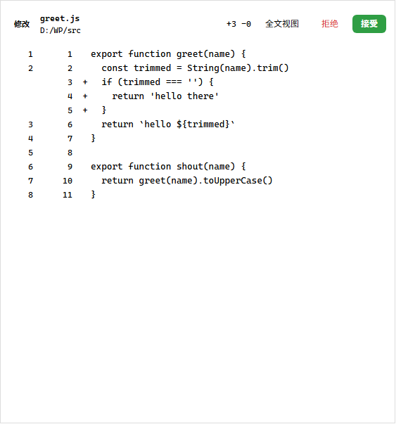
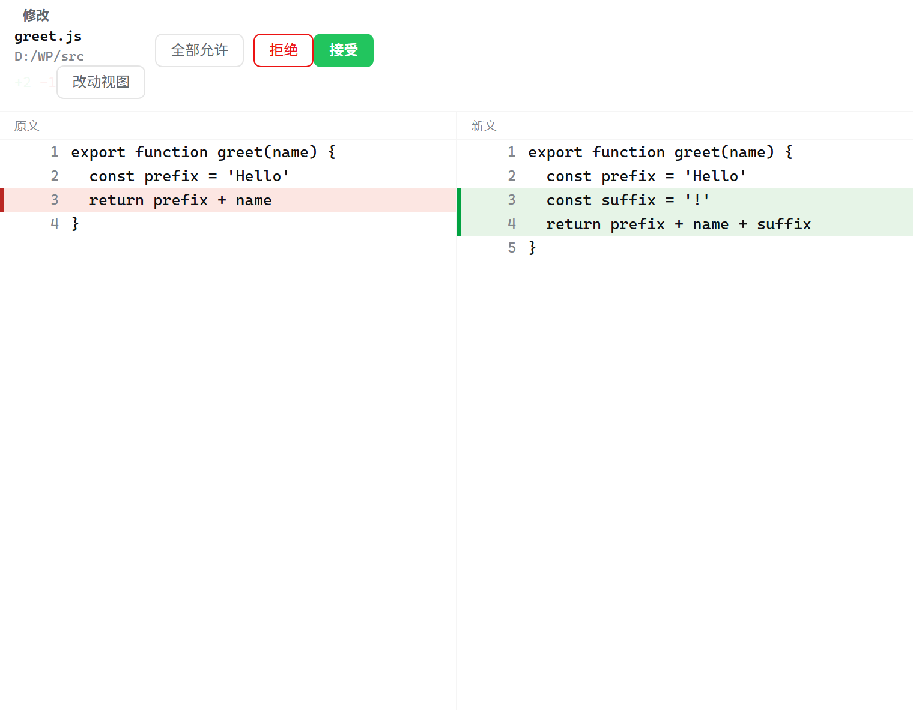
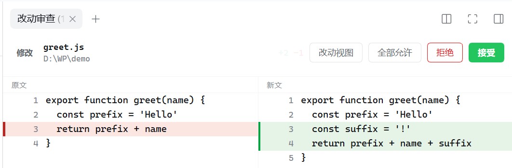
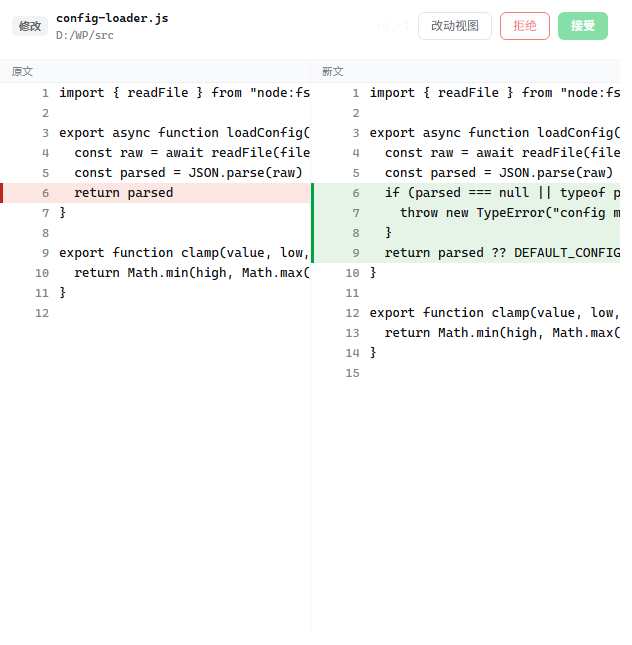
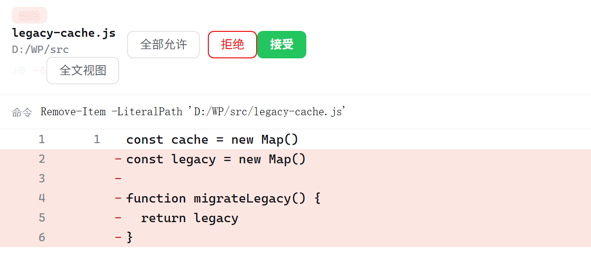
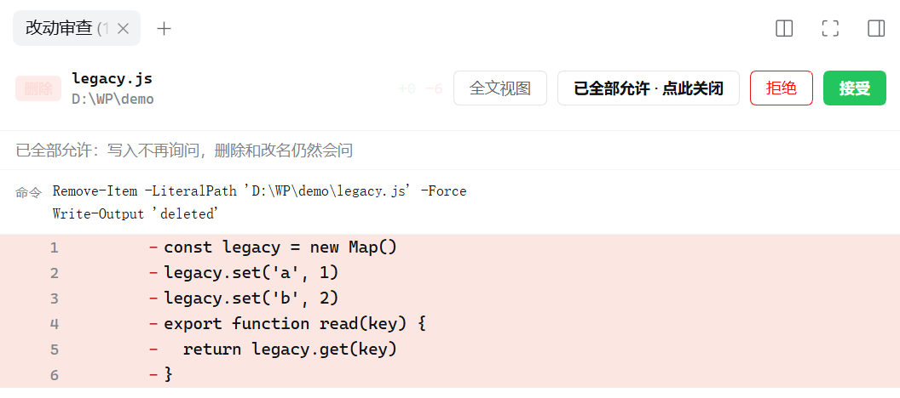

# dsh-diff-review

> **改动发生前**先审查。模型要写、改、删文件时，右侧边栏弹出原文与新文的对比，你点「接受」它才真正落盘。

DeepSeek Harness 插件。零运行时依赖，不改宿主任何内置插件。



---

## 它解决什么问题

模型直接改文件，你只能**事后**从对话里翻 diff，发现改错了还得自己回滚。这个插件把闸门挪到**动手之前**：

```
模型：我要把 greet.js 的第 4 行换掉
插件：↓ 暂停，不落盘
      右侧边栏显示 —— 第 4 行 红底删除、第 4~5 行 绿底新增
      改动到的那几个字再加一层深色
你：  [接受]  → 才真的写进去
      [拒绝]  → 文件一个字节都没动，模型收到拒绝原因
```

拒绝是**真的没写**，不是写完再回滚。

## 界面

### 改动视图（默认）

统一 diff，左右两列行号，`+`/`-` 标记，未改动处折叠成「⋯ 未改动的 N 行」。被改写的行除了整行底色，**改动到的那几个字**还会再加一层更深的底色。


### 全文视图

原文 / 新文左右并排，行号跟文件真实行号走，改动行在左边距画彩色竖条（编辑器的 gutter 效果）。**拖或滚任意一侧，另一侧的行与列同步跟动。**



改成大段落的场景，左边删掉的整行和右边新增的整行在各自栏里对齐，一眼能看出哪几行是被替换掉的：



### 命令级审查

命令要碰的文件或内容只有 shell 运行时才知道（`iex $code`、内容来自 `$env:USERNAME`）——面板给完整命令行，并明说为什么算不出 diff。



### 删除级审查

`pwsh` 里的 `Remove-Item` / `rm` / `[IO.File]::Delete` 这类删除命令，面板把**将被删掉的整段原文**逐行标红列出来，一并给出原始命令行——先看清楚要没的是什么，再决定。



文件越长，「要没的是什么」越该看全：整段原文逐行标红，滚到底才能点「接受」：



### 多文件审查

一条命令动好几个文件时，上面多一条文件条：`N 个文件` + 每个文件一格，格子里是它的操作徽章、文件名和 `+N -N`（二进制说字节数）。**点哪一格就切到哪个文件的 diff**，接受/拒绝仍然只有一个按钮——shell 那条命令还是一条命令。

以前这种情况整条降级成「无法预知最终内容」，哪怕两个文件的新内容都是命令里写死的字面量。现在每个文件各算各的：能算的给真 diff，算不出的那一格自己标「该文件内容未变」或空白，不影响其它格。

### 二进制 / sourcemap / 纯格式变化

这三种不画行级 diff，因为画出来没人读得下去：

| 情形 | 面板说什么 |
|---|---|
| 二进制（`.png`/`.zip`/`.exe`/`.pdf` 等，或读不出 UTF-8） | `二进制文件，N → M 字节` |
| `.map` sourcemap | `sourcemap，N → M 字节` |
| 只是换行符变了（LF ↔ CRLF） | `仅换行符变化（N → M 字节）` |
| 只是缩进/行尾空白变了 | `仅格式变化（缩进与空白），行内容未变` |

二进制只按字节数审查，**永远不给还原按钮**（没读到文本，没有可还原的副本）。纯换行与纯格式变化仍算改动、仍可还原，只是单独标出来——把四百行重新缩进画成四百行红绿，是最吵闹的「什么都没变」。

## 拦什么

| 操作 | 拦不拦 | 面板显示 |
|---|---|---|
| `write` 新建 / 覆盖 | 拦 | 新增或修改，全文 `+N -N` |
| `edit` 改文件 | 拦 | 统一 diff / 全文双栏，标出改动行 |
| `pwsh` 里的删除、覆盖命令 | 拦 | 命令原文 + 原文/新文 diff（能确定时） |
| 第三方 / MCP 工具的写操作 | 拦 | 按参数判定：名字或 `op` 里有增删改动词 + 参数里有真实路径，才拦 |
| `read` / `glob` / `grep` / 查看器 / 数据库查询 | 不拦 | — |

判定不看工具名白名单：**只有真正会改文件的调用才拦**。判据是「变异动词 + 真实路径」两半同时成立——`mcp__fs__write_file({path, content})` 拦，`mcp__fs__read_file({path})` 放行，`grep({pattern: "write", path})` 放行（动词出现在检索词里不算操作），`write_log({level, message})` 放行（有动词没路径，改不了文件）。

### `pwsh` 按「形状」识别，不靠命令名单

记住命令名单永远会漏。所以只要这条命令**可能改写文件**就先问你，判据是四类形状：

| 形状 | 例子 |
|---|---|
| PowerShell 动词-名词约定 | `Set-` `New-` `Remove-` `Clear-` `Rename-` `Move-` `Copy-` `Add-` `Out-` `Tee-` `Write-` `Save-` `Export-` `Import-` `Compress-` `Expand-` `Restore-` |
| .NET 成员调用 | `[System.IO.File]::Delete(...)`、`[IO.File]::WriteAllText(...)` |
| 把代码当字符串交给别的程序 | `cmd /c del`、`iex`、`powershell -EncodedCommand`、`node -e`、`python -c`、`bash -c` |
| 原地改文件的外部工具 | `git clean` / `git checkout -- ` / `git reset` / `git stash`、`truncate`、`dd`、`shred`、`unlink` |

所以 `Set-Item`、`New-Item`、`Tee-Object`、`Export-Csv`、`Rename-Item` 这些没被逐个列出的命令**同样会拦**。只操作内存的 `New-Object`、`Add-Type`、`Set-Variable`、`Clear-Host` 显式放行。

`.NET` 调用看的是**谁在调用**，不是成员名叫什么：`[SHA256]::Create()` 和 `[File]::Create('a')` 同名，前者只造一个内存里的哈希对象。所以一个成员调用只有在**所属类型够得着磁盘**（`File`/`Directory`/`FileInfo`/`DirectoryInfo`/`StreamWriter`/`ZipFile`/`FileSystem`…）**或者**第一个实参就是路径时才算改写。读字节、算哈希、编码转换（`[IO.File]::ReadAllBytes`、`[Text.Encoding]::UTF8.GetString`、`[IO.Path]::GetFileName`）都不会弹。


另外覆盖：

- 常见别名（`ri`/`rm`/`del`/`erase`/`rd`/`rmdir`/`clc`/`cli`/`ren`/`rni`/`mi`/`mv`/`sc`/`ac`/`cpi`/`cp`/`tee`/`ni`/`si`/`sp`/`mkdir`/`md`）与 `>` `>>` `2>` 重定向
- **脚本块里的命令**同样算数：`if (Test-Path $t) { Remove-Item $t -Force }`、`foreach (...) { ... }`、`& { ... }` —— 藏在里面的删除不会漏
- 带 `-WhatIf` 的干跑、只读管道、`git status` / `git log` / `git diff` 一律放行

### 「清空文件」不算删除

`Clear-Content` / `clc` / `Clear-Item` **不算删除**：文件还在，只是内容没了，面板显示成「所有行被删掉」的 diff，`全部允许` 也照样放行。

真正让文件**消失或换位置**的才算：`Remove-Item`、`del`、`rd`、`Rename-Item`、`Move-Item`、`Clear-RecycleBin`。

## 能不能给我看 diff？

### 能算出新内容 → 给完整 diff

写入内容在命令里就写死了，且目标文件能读。所谓「写死」包括：

- **引号里的字面文本**：`Set-Content -Path 'a.txt' -Value 'hello'`、`'hello' > 'a.txt'`
- **同一命令里先赋值再写出的变量**：`$t = 'hello'; Set-Content -Path a.txt -Value $t`
- **.NET 调用的前两个实参**：`[System.IO.File]::WriteAllText('a.txt', 'hello')`
- **`$"..."` 里的插值**（引用的变量也确定时）：`` $dir = 'D:\w'; $js = "line one`nline two"; Out-File "$dir/probe.js" -InputObject $js `` → 解析成真实路径与真实三行文本（`` `n `` `` `t `` 一并还原）
- **here-string**：`@'...'@` 原样、`@"..."@` 插值。正文里的 `|`、`&`、花括号、引号都不会被当成命令分隔符

`Add-Content` / `Out-File -Append` 按追加算，新文件按新增算。

### 算不出来 → 只确认命令本身

路径或内容只能由 shell 运行时决定时，**只在会删东西、或同时碰多个文件时才弹**：

| 情形 | 举例 |
|---|---|
| 通配符 | `*` `?` `[` `]` |
| 没被赋值的变量 | `$env:TEMP\x`、`$(...)`、`${...}` |
| 运行期才算出来的值 | `$t = 'a' + 'b'`、`Get-Date \| Out-File f` |
| 属性 / 索引访问 | `$a.Length` |

一个已知文件、内容看不见的写入（`Set-Content -Value $x`、`$js > file`）**直接放行** —— 让人审批自己看不见的字节是问不出答案的噪音。

真要弹时，面板先给「这条命令会做这些事」的步骤清单（`切换目录` / `设置` / `写入 <文件>` / `删除 <文件>` / `交给别的程序`），原命令折在下面点一下就展开 —— 不再是把三十行单行命令整条甩给你读。

清单按**整句**给，不按分隔符切：`splitStatements` 会把 `|`、`&`、`{}` 也断开（闸门需要这样才不会漏掉藏在 `if` 里的删除），但一句 `(… | ForEach-Object { … }) -join ''` 断成四段之后，四行都读不出原意。所以括号不平衡的碎片会被并进把它补全的那一句，等你看到的是完整的一步。

两个例外：

- **`$env:NAME` 能查**：`Remove-Item "$env:TEMP\a.txt"` 会还原成真实路径 —— 落在临时目录的照放行，落在别处的照常问
- **逗号并列多目标**（`Remove-Item 'a.txt','b.txt'`）各自独立解析
- 文件名里本来就有的 `$`（如 `a$b.txt`）不算展开，仍按真实路径审查

### 内联脚本先看它写了什么

`node -e`、`python -c`、`py -3 -c` 这类把源码写在命令行里的调用，**先判断这段源码会不会写盘**：

- 只读（读文件、打印、算长度、`readdir`、读 csv）→ **直接放行**，不再弹面板
- 出现写盘调用（`writeFileSync`、`appendFileSync`、`unlink`、`mkdirSync`、`shutil.copy`、`os.replace`、`to_csv`、`savefig`…）→ 照常弹，并给出步骤清单
- 出现以写模式打开的 `open(..., 'w')`、`(..., 'a')`、`(..., 'x')`、`(..., 'r+')` → 照常弹
- 出现能把控制权交给别的程序的东西（`child_process`、`execSync`、`spawn`、`eval`）→ 撤销只读判断，照常弹

`cmd /c del x`、`bash -c 'rm …'` **不**走这条判断：它们的 payload 是 shell，用一份 JS/Python 词表去判会把没列进词表的删除当成无害。这两种仍然整条确认。

一段源码只要有一处说不清，整条命令就照常弹 —— 放行的门槛是「整条命令的每个内联脚本都被判定为只读」。

## 什么不会拦

- 只读工具
- 系统临时目录（`%TEMP%` / `%TMP%` / `/tmp`）
- 工作区下的 **`.dsh/` 整个目录**（一次性脚本、导出、截图、插件状态都落那儿）
- **生成物目录**：`__pycache__`、`node_modules`、`dist`、`build`、`out`、`target`、`coverage`、`.venv`、`vendor` 等（工具自己产出的东西，问你也是白问）
- **插件自己的源码**（否则插件改坏了就再也修不回来）

除此之外，只要落盘就一定会先问你。`.git/` 不在豁免之列——`hooks/pre-commit` 下次提交就会执行。

## 面板细节

**顶栏**：操作徽章（新增 / 修改 / 删除 / 命令）+ 文件名与目录分两行（像编辑器的标签页）+ `+N -N` + 视图切换 + 拒绝 + 接受。

只有命令级能确认的改动（`iex $code`、`git clean -fdx`）根本没有文件名，此时徽章写「命令」、下面直接给命令原文，**不会把动词当成文件名**。

- **多个待审项**在左侧列表纵向排列，逐条接受或拒绝
- **审查属于它所在的对话**：待审队列进程内共享，但每个标签页只看、只决定自己对话的改动；`(N)` 也只数自己这个对话。别的对话的记录既看不到、也读不到 diff、也接受不了（服务端按 `sessionId` 校验归属，不靠前端过滤）
- **字体**：代码区 13px/20px，等宽栈 `JetBrains Mono → Fira Code → Cascadia Code → Consolas`，关闭连字（连字会把 `!=`、`->` 画变形）；正文系统无衬线
- **配色**：全部走宿主的 `--dsw-alias-file-diff-*` token，跟随亮/暗主题自动切换，不写死颜色
- **空态**：显示提示，并把闸门自检信息收进一张卡片

### 全部允许

懒得一条条点时按它：**这个对话**里后续写入不再询问，直到你再点一次关掉（重启 DSH 也恢复询问）。

- **按对话记**：这里打开不会替你放行别的对话，关掉也不会把别人的开关一起关掉
- 按钮**一直在顶栏**，包括清空后的空面板（放行之后没待审项，那正是你会停留的页面，开关不能跟着消失）
- 放行时变成「已全部允许 · 点此关闭」，随时能撤回
- 按下去会顺手接受屏幕上那一条
- **只有文件本身被拿走才照问**：`Remove-Item`、`del`、`rd`、`Rename-Item`、`Move-Item`
- 同一条命令里「写出临时文件 → 用掉 → 删掉」不算删除（那个文件本来就不存在，删它什么都没丢），整条直接过
- **放行不等于不记**：被它放过的写入照样进「历史」，条目标「开关放行」，事后一样能还原。开关承诺的是「别再问我」，不是「别记得」

它的位置介于 Claude Code 的两个模式之间：比 `acceptEdits`（自动接受编辑、Bash 仍要问）宽一点，命令里的写入也一并放行；比 `bypassPermissions`（什么都不问）窄一点，删除和内容不可知的命令仍然停下来问。文件名和删除是不可逆的，这两件事不问就等于替你答了。

### 历史与还原

顶栏的「历史」按钮切到另一个屏幕：**本对话审查过的改动**，从新到旧，带结果（已接受 / 已拒绝 / 已超时 / 已取消 / 开关放行）。

只记**新增 / 修改 / 删除**这三种真正落到文件上的操作。命令级条目（`iex $code`、只知命令不知效果的那种）不进历史——它没有可指认的文件，既还不了原也算不上一条改动，收进去只会把历史变成没人翻的日志。

- 每条在**受理之前**就已经抓好了原文快照，所以哪怕是你点了「接受」、5 分钟超时自动放行，或者被「全部允许」直接放过，都能在这里把它还给磁盘
- 被开关放过的条目标「开关放行」而不是「已接受」：没人看过它，列表不该假装看过
- 能还原的条目右边有「还原」；还原过的会标「已还原」，再点是拒绝（`already-restored`）
- **文件在那之后又变过就拒绝**：还原前会核对当前内容是否仍是那次改动写下去的样子（删除则核对文件是否仍然不存在），不一致直接报「文件在此之后又变过，已拒绝还原」。宁可不动，也不悄悄覆盖别人后来的写入
- **没落盘的改动不给还原**：已拒绝的、还在待审的都没有按钮（`not-applied`）
- **读不出原文的不给还原**：超 2MB 的快照、被 `MAX_STORED_CHARS` 截断的改动只留记录，按钮不出现——用半截原文还原会把文件尾部切掉
- 快照存在 `~/.dsh/diff-review/history/`，按对话分目录、内容寻址去重（同一份原文写两次只占一份），每对话上限 200 条 / 128MB，超了从最旧的开始删

## 安全阀

| 情形 | 行为 | 原因 |
|---|---|---|
| 侧边栏没打开 / 页面已关闭 | 放行 | 没人能审批时不能把 agent 卡死 |
| 你中断本轮（Esc） | 取消当次调用 | 跟随 `exec.signal` |
| 5 分钟没人理 | 放行 | 未答复不等于拒绝；原文快照已经抓好，事后仍可在「历史」里还原 |
| 插件自己的源码 | 放行 | 否则插件坏了就再也修不了（自锁） |
| 临时目录 / 工作区 `.dsh/` | 放行 | `skipTemp` / `skipScratch`（`.dsh-tmp`、`.dshtmp` 这类只是名字像的不在此列） |
| 生成物目录（`__pycache__`、`node_modules`、`dist`、`build`、`out`、`target`、`obj`、`coverage`、`.venv`、`vendor` 等） | 放行 | `skipNoise`。整段匹配：`dist/` 跳过，`distro/`、`my-dist/`、`builder/` 照问；`bin`/`lib`/`public`/`src` 这类可能有人手写文件的目录、以及 `.git/`（`hooks/pre-commit` 会在下次提交时执行）**都不在名单里** |
| 二进制 / sourcemap | 按字节数报告，不给行级 diff、不给还原 | 读不出行就别假装能 diff；没有文本副本就没有可还原的字节 |
| 纯换行 / 纯格式变化 | 照常出条目、照常可还原，只多一行说明 | 字节确实变了，但把它画成四百行红绿等于什么都没说 |
| 命令写入内容由 shell 决定 | 只碰一个已存在的文件就放行；删除、多目标、`iex`/`node -e` 仍照问 | 看不见的字节问不出答案；但删掉的东西拿不回来 |
| 一条命令同时碰多个文件 | 照常弹一次，文件条里逐文件切换各自的 diff | 文件名本身就是这次审查要确认的东西 |
| 按了「全部允许」 | 本对话所有写入直接放行，直到手动关掉 | 文件被删除或改名仍照问；写出又删掉的临时文件不算；**放过也照样记历史** |

## 安装

```powershell
dsh plugin add https://github.com/wyk4447/dsh-diff-review.git
# 或简写
dsh plugin add github:wyk4447/dsh-diff-review
```

装完在 profile 的 `package.json` 里是版本号 / 仓库形态，与其它插件一致。改代码后需重装一次。

> **Fork 了？** 把上面两行的 `wyk4447` 换成你自己的用户名。

> **兼容的 DSH 版本**：`engines.dsh` = `>=0.2.1-rc.1 <0.3.0-0`（整个 `0.2.x`）。DSH 导入前会比对这条范围（预发布版参与匹配），不匹配就拒绝加载整个插件、把它变成一条 `disabled: true` 的孤儿行。0.1.0 写的是 `<0.2.2-0`，升级到 DSH `0.2.2-rc.1` 后就会被判不兼容；0.1.1 起放宽。

> **构建脚本**：Git 托管的插件靠 `prepare` 脚本构建，pnpm 默认拦 `allowBuilds`。本插件**零依赖、没有任何 `prepare`/`install` 脚本**，正常不需要放行；只有你在这仓库里自己加了构建步骤时，才需要把 pnpm 打印的 key 写进 `~/.dsh/profiles/<profile>/pnpm-workspace.yaml` 的 `allowBuilds`。

### 本地开发（软链）

```jsonc
// ~/.dsh/profiles/<profile>/package.json
// dependencies 里加：
"dsh-diff-review": "link:<你 clone 下来的绝对路径>"
// dsh.profile.bundles 里也加 "dsh-diff-review"
```

改 `lib/*.js` 需重启 DSH 才生效（profile bundle 随 Host 启动加载，没有热重载）。

## 配置

在 `~/.dsh/profiles/<profile>/cordis.patch.yml` 里给对应条目加 `config:`：

```yaml
- id: diff-review
  name: dsh-diff-review
  config:
    files: true          # 拦 write/edit
    shell: true          # 拦 pwsh 里的破坏性命令
    skipTemp: true       # 跳过系统临时目录
    skipScratch: true    # 跳过工作区 .dsh 整个目录
    skipSelf: true       # 跳过插件自身（强烈建议保持 true）
    skipNoise: true      # 跳过生成物目录（__pycache__/node_modules/dist/.git …）
    history: true        # 抓原文快照，让已接受的改动能在「历史」里还原
    trace: true          # 写诊断日志到 ~/.dsh/logs/diff-review.log
    timeoutMs: 300000    # 文件审查超时（毫秒）
    shellTimeoutMs: 120000
```

所有键都可省略，缺省用上面的值。类型不符的键会被忽略（不做强制校验，插件零依赖）。

## 卸载

1. 删 `cordis.patch.yml` 里 `- id: diff-review` 那段（若你手动加过）
2. 从 profile `package.json` 的 `dsh.profile.bundles` 与 `dependencies` 里移除
3. 重启 DSH

本插件**没有**关掉任何内置插件，也没有改写宿主的 `disabled` 列表，卸载不留副作用。

## 自测

两套离线测试，不连 GUI、不写真文件：

```powershell
node test\gate.test.mjs     # 闸门：拦截 / 放行 / 接受 / 拒绝 / 中断 / 自我豁免 / 兜底 / 还原 / 多文件 / 二进制 / 格式化
node test\render.test.cjs   # 面板：空态 / 改动视图 / 全文视图 / 滚动同步 / 多文件 / 命令级 / 全部允许 / 历史 / 侧栏图标
node test\history.test.mjs  # 快照库：去重 / 上限回收 / 跨对话隔离 / 索引损坏 / 可还原性判定
```

> 别用 `node --run test` / `npm test`：Windows 上 Node 在含非 ASCII 字符的路径下会算成乱码路径而报「Can't find package.json」。`package.json` 里仍留了 `scripts.test`，放在纯 ASCII 路径下可用。

> 闸门与快照测试都把存储根指到系统临时目录（`DSH_DIFF_REVIEW_HISTORY_ROOT`）并在结束时删掉，跑测试不会往你的 `~/.dsh` 里塞任何东西。

<details>
<summary><b>闸门测试覆盖的 352 项断言</b>（点开）</summary>

`not-armed` 放行、布防后挂起、`decide accept` 放行、`decide reject` 拒绝且 reason 带路径、`abort` 取消、`edit` diff 两侧、`pwsh` 删除挂起与接受、`pwsh` 字面写入出真 diff（覆盖 / 追加 / 重定向 / 新建四种）、同一命令里赋值后写出的变量（`$t = 'one'; Set-Content -Value $t`、反引号转义还原、`$p = 'D:/w/a.txt'; Remove-Item $p` 解析成真实文件、`$dir` 参与路径拼接、`"hello $n"` 插值）、运行期才算出来的值不再弹（`$t = 'a' + 'b'`、`$env:USERNAME`、`$js > a.txt`）、按形状识别的改写命令（`Set-Item`/`Rename-Item`/`New-Item`/`Tee-Object`/`Export-Csv`/`[IO.File]::Delete`/`cmd /c del`/`iex`/`Invoke-Expression`/`node -e`/`python -c`/`powershell -EncodedCommand`/`git clean`/`git checkout --`/管道右端无目标）且参数是字面量时仍出真 diff、形状命中但没有文件名的条目（`iex`/`git clean`/管道右端）标记为命令级且不带路径（`op === 'shell'`、`displayPath` 为空，避免把动词当成文件名）、只碰一个已知文件且内容看不见的写入放行、`-WhatIf`/`Get-ChildItem`/`Write-Host`/`New-Object`/`Add-Type`/`Clear-Host`/`git status`/`node --version` 放行、通配与变量目标的命令级确认（`$p`/`"${target}"`/`$out`）且文件名里的字面 `$` 不被误判、脚本块里的删除（`if (...) { ... }`、`foreach (...) { ... }`、`& { ... }`）、同一命令内赋值参与路径解析、逗号并列多个目标、同一文件被写两次时顶栏只出现一次而两个不同文件按顺序都出现、`$env:TEMP` 目标按临时目录放行、自我豁免、临时目录豁免、工作区 `.dsh/` 整个目录豁免且不误豁免 `.dsh-tmp`/`.dshtmp`、`header.cwd` 缺失时用 `workingDirectory` 兜底、`ctx.get` 抛异常时仍能挂起、**全部允许**（同一轮里后续写入直接放行且诊断记为 `allow-all`、文件被删除或改名仍照问而 `Clear-Content` 直接过、`turn/end` 与新一轮提问都不动这个开关、关掉开关不需要有待审项、关掉之后的下一次写入重新挂起、**按对话记**——开在一个对话上不会放行另一个、关掉一个不会动另一个、不带对话的开关请求被拒绝 `missing`）、同一条命令里写出来又删掉的临时文件直接放行而删掉一个本来就存在的文件仍照问、**一个对话的改动不会被另一个对话看到或决定**（`list` 只回本会话、`detail`/`decide` 对别的会话返回 `missing` 且记录仍挂着）、**还原链路**（接受过的写入出现在历史里且带 `accepted` 状态与可用快照、还原后文件回到原文、第二次还原被拒 `already-restored`、文件在审查之后又被改过则拒绝还原 `stale` 且新内容保留、已拒绝的改动不给还原 `not-applied`、删除可以还原且字节真的回来了、别的对话既看不到这些历史也还原不了、不存在的 id 返回 `missing`）、**多文件审查**（一条命令碰两个文件只挂起一次、`files` 里两条、`detail.files` 各带自己的 rows 与新文与路径、接受后放行）、**二进制**（`.png` 被识别成 `binary`、不给行数、报 `0 → 1` 字节、`reviewable` 为真、不说「无法预知」、接受后放行）、**纯格式与纯换行**（重新缩进标 `note === 'formatting'`、CRLF 重写标 `note === 'line-endings'`，两种都仍可接受）、**按参数判定**（`mcp__fs__write_file` 被拦且新文能出 diff、`mcp__fs__read_file` 放行、`grep({pattern: 'write'})` 放行、`write_log({level, message})` 无路径放行）、**内联脚本只读识别**（`node -e` 读文件打印长度、`node -p process.version`、`python -c` 读文件打印、`sys.stdout.write` 打印、`console.log('write this to stdout')`、`readdirSync` 列表、`csv.reader` 读表共七种放行；`writeFileSync`、`appendFileSync`、`promises.unlink`、`open(...,'w')`、`shutil.copy`、`os.replace`、`child_process.execSync`、`eval(payload)` 共八种照常挂起并标 `shell-command`；一条只读脚本配一条写入脚本时整条仍挂起；**当初引发这次改动的「读 YAML 打印两个长度」那条命令不再挂起**）。
**`.NET` 按归属判定**：`[SHA256]::Create()`、`SHA256]::Create()` 后接 `ComputeHash`、`ReadAllBytes` + `Encoding::UTF8.GetString`、`Path]::GetFileName` 四种只碰内存的调用都放行；路径是表达式的 `[System.IO.File]::WriteAllText($p, …)` 仍挂起；当初被误拦的那条算哈希命令不再挂起且队列清空。
**步骤清单**：管道脚本挂起后 `steps` 非空、每一步括号都平衡、`(… | ForEach-Object { … }) -join ''` 合并成一步而不是碎成四段、没有一步只剩一个括号。

</details>

<details>
<summary><b>面板测试的 10 组覆盖 + 快照库 58 项断言</b>（点开）</summary>

用 `node:vm` 跑真实的 `lib/client.js`，桩掉 React/DOM/fetch，共 10 组：`empty diag`、`unified + full`、`multi-file review`、`scroll sync`、`command-level review`、`allow-all-switch`、`session-scoped title`、`guide artwork`、历史屏幕、`client render smoke`。

具体验证：空态六行诊断（最后一行「轮次」，宿主一次都没报过轮次时显示 `-`）、改动视图有 `+`/`-` 标记、改写行只有真正变化的那几个字被加深高亮（前缀不被误涂）、全文视图有双栏与 gutter 竖条、**拖动一侧另一侧同步且不回弹**、**多文件时上面出现文件条并写「2 个文件」、列出两个文件名、默认画第一个文件的 diff、二进制那格报字节数而不是「该文件内容未变」**、删除态第二栏显示「文件将被删除」、命令级审查不出空代码区且用「无法预知最终内容」而不是「改动过大」、**命令级审查先给步骤清单（`切换目录`、`设置`、`写入` 三行，并单独点出目标文件）、原命令默认折叠、点开后才显示原文并能再收起**、命令级条目不再编造文件名（`iex $code` 的面板不显示任何文件名）、「全部允许」开关始终在顶栏、**放行之后队列清空的那一屏也仍然在**、**一个对话的开关状态不会串到另一个对话**、关掉后仍能找到入口、**标签页计数只算本对话**、侧栏「开始」页的画走 `guide` 条目自己的 `icon`（不是清单里的 `icon.svg`）、**历史屏幕在有记录时列出条目并标「已还原」、且只给唯一一条可还原的条目出「还原」按钮（已还原的、已拒绝的、快照不完整的都不出）**。

`test/history.test.mjs` 直接测快照库本身：记录被拒的条件（无会话 / 无路径 / 多目标命令 / 内容不可知的命令 / **命令级条目** / **未知操作名**）、截断的快照只留记录不可还原、删除按「文件应当不存在」校验、新建可撤销、关闭开关后全静默、跨对话隔离、**会话 id 带 `../` 不会逃出存储根**、最新在前、内容寻址只存一份 blob、超 200 条从最旧开始删且回收孤儿 blob、索引损坏读成空且之后仍能写入、`forget` 幂等、超 2MB 的快照记条目但不可还原。

</details>

## 排错

没被拦住时，先看日志，再看面板。

### 日志（推荐，不依赖打开侧栏）

`trace: true`（默认）时，每次闸门调用、挂起、裁决、路由拒绝都会追加一行到 `~/.dsh/logs/diff-review.log`（Windows：`C:\Users\<你>\.dsh\logs\diff-review.log`）。

```powershell
Get-Content ~\.dsh\logs\diff-review.log -Tail 30
# 只看某个工具
Select-String -Path ~\.dsh\logs\diff-review.log -Pattern '"tool":"write"'
```

日志只记**状态变化**：轮询心跳首次出现或间断后恢复各记一次（`poller`），不会每 1.2s 刷屏。没有 `poller` 行 = 浏览器半从没连上，闸门必然一直「未布防」。

典型序列：

```
... poller {"first":true,"gapMs":-1}                  ← 侧栏连上，闸门开始布防
... park {"tool":"write","path":"...","pending":1}    ← 拦下了，等你点按钮
... verdict {"id":"...","outcome":"accept"}           ← 你点了接受，随后工具真的执行
```

### 面板

打开右侧「改动审查」Tab，空态直接列诊断：

- `闸门已检查 N 次 · 最近工具 X · 结果 Y` —— `Y` 是放行原因，见下表
- `布防 no · 心跳龄 -1ms` —— 页面从没轮询过，即 Tab 没打开
- `最近调用：write:not-armed → read:not-gated` —— 按时间顺序看最近 12 次

| `结果` | 含义 |
|---|---|
| `not-armed` | 侧边栏没在轮询（Tab 没开 / bundle 没加载），正常放行 |
| `not-mutating` | 工具的名字与参数都看不出在改文件（`read`、`grep`、`web_fetch`、查看器、数据库查询） |
| `no-session` | 拿不到会话工作目录 |
| `temp-skipped` / `scratch-skipped` / `self-skipped` / `noise-skipped` | 命中临时目录 / 工作区 `.dsh/` / 插件自身 / 生成物目录豁免 |
| `identical` / `edit-no-match` / `edit-ambiguous` | 改动本身无效或歧义，交给宿主自己报错 |
| `shell-not-destructive` | `pwsh` 命令不含破坏性操作 |
| `script-read-only` | 命令里是 `node -e` / `python -c` 这类内联脚本，且每段源码都只读（不写盘、不以写模式 `open`、不启动别的程序） |
| `intent-skipped` / `intent-error` | 看着像在改文件，但路径落不到存在的文件上 / 读路径时出错 |

## 实现要点

- **闸门**：`tools/pre-execute` 的 async waterfall。挂起时只 await 一个 Promise，同时监听 `exec.signal`，宿主等多久都不会 abandon 我们的 promise。
- **拦谁**：不靠工具名白名单。`write`/`edit`/`pwsh` 是精确 diff 的已知工具，其余一律按参数判定——工具名或 `op`/`action`/`type` 参数里出现变异动词，**且**参数里有真实路径，两者同时成立才拦。这样第三方 MCP 文件服务也能被拦，而 `grep({pattern: "write"})` 不会被误拦。
- **多文件**：一条命令按路径分组，每组独立 replay 出 before/after，`files[]` 随 `list` 只发摘要、随 `detail` 发全部 rows。面板切文件是本地状态，不发请求。
- **二进制 / 格式噪音**：扩展名先判 `kind`（`text`/`binary`/`sourcemap`），二进制只算字节数不读文本；文本再判 `note`（`line-endings`/`formatting`）。`computed`（有真 diff）与 `understood`（知道结果，哪怕只是字节数）分开，只有前者能驱动快照——二进制没有文本副本，所以永远不给还原。
- **内联脚本**：`node`/`python` 带 `-e`/`-c` 时先取 payload 原文，抹掉字符串字面量与 `console.log`/`process.stdout.write`（打印不是写盘），再把标识符去掉下划线后比对写词表；`open` 的写模式靠正则带调用括号判，避免只读脚本被拦。任何一处判不清就整条照常确认，`cmd /c`、`bash -c` 不走这条捷径。
- **步骤清单**：算不出 diff 的命令在服务端就按语句拆成 `steps[]`（`cd`/`note`/`write`/`delete`/`run`/`opaque`），随 `list` 一起透出。面板先画清单、原命令折叠；没有清单时原命令直接展开，不会出现「藏起来的唯一审查内容」。括号不平衡的碎片会并进补全它的那一句 —— `splitStatements` 的断句是为闸门服务的，不该决定读者看到几行。
- **`.NET` 归属**：成员名只是线索，`::` 前面的类型才是判据。`SHA256]::Create()` 造的是内存对象，`File]::Create('a')` 才碰磁盘；两者同名。所属类型够不着磁盘**且**没有路径实参时，这个调用不算改写。
- **通道**：自建同源 HTTP 路由 `/diff-review/api/{list,detail,decide,history,restore}`，前面挂 `ctx.connection.requestRejection` 做浏览器信任校验。Electron 壳把 `dsh-app://app/` 的请求转发到 Host 并自动带认证 cookie，所以浏览器侧同源可达；从 Node 直接探测会 403，属正常。
- **diff**：自己算 LCS（`Int32Array` DP，超 400 万格降级为全删全增），零外部依赖。
- **布防**：侧边栏每 1.2s 轮询 `list`，该调用同时刷新心跳；心跳 180s 内有效才算「布防」，否则一律放行。窗口不可见时 Chromium 把 `setInterval` 压到约 60s 一跳，窗口必须留得比这个大，否则切走窗口就等于放行。
- **快照**：`lib/history.js`，整份原文副本而不是补丁链（补丁链要每一跳都能重放，副本就是状态本身，还原不会半路失败）。内容寻址（`sha256` 命名 blob）自动去重，`index.json` 先写 `.tmp` 再 rename，索引坏了读成空而不抛。抓取时机在**你答复之前**——超时是 fail-open 放行，等答复完再抓原文已经没了。删除走 `ctx.fs.deleteFile`、还原走 `ctx.fs.writeText`，前后按 `verify` 校验当前内容，所以 `ctx.fs` 仍是唯一真正动用户文件的东西。
