# dsh-diff-review

[](CHANGELOG.md)
[](https://github.com/wyk4447/dsh-diff-review#%E5%AE%89%E8%A3%85)
[](LICENSE)

> **改动发生前**先审查。模型要写、改、删文件时，右侧边栏弹出原文与新文的对比，你点「接受」它才真正落盘。

DeepSeek Harness 插件。零运行时依赖，不改宿主任何内置插件。从 0.1 到 1.0 的改动见 [CHANGELOG](CHANGELOG.md)。

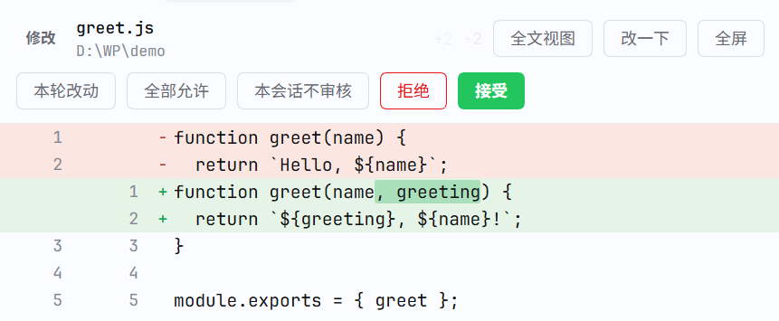

---

## 它解决什么问题

模型直接改文件，你只能**事后**从对话里翻 diff，发现改错了还得自己回滚。这个插件把闸门挪到**动手之前**：

```
模型：我要把 greet.js 的第 4 行换掉
插件：↓ 暂停，不落盘
      右侧边栏显示 —— 第 4 行 红底删除、第 4~5 行 绿底新增
      改动到的那几个字再加一层深色
你：  [接受]  → 才真的写进去
      [拒绝]  → 文件一个字节都没动，模型收到拒绝原因
```

拒绝是**真的没写**，不是写完再回滚。

## 界面

### 改动视图（默认）

统一 diff，左右两列行号，`+`/`-` 标记，未改动处折叠成「⋯ 未改动的 N 行」。被改写的行除了整行底色，**改动到的那几个字**还会再加一层更深的底色。


### 新增文件

新建文件没有「原文」可对比，整篇都是新内容，所以整片绿、行数写 `+N -0`——一眼能看出这不是改了哪儿，而是凭空多了一整个文件。

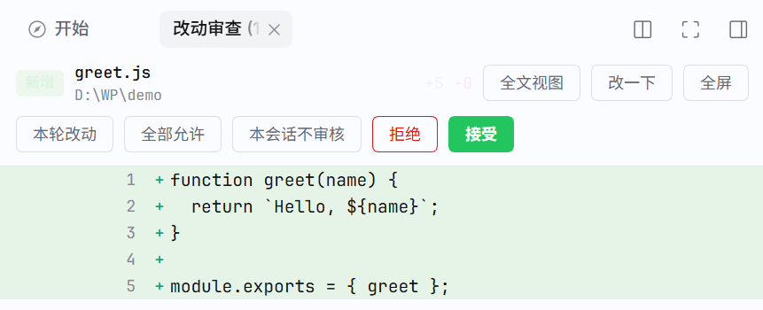

### 全文视图

原文 / 新文左右并排，行号跟文件真实行号走，改动行在左边距画彩色竖条（编辑器的 gutter 效果）。**拖或滚任意一侧，另一侧的行与列同步跟动。**

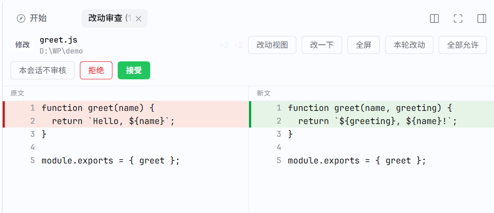

改成大段落的场景，左边删掉的整行和右边新增的整行在各自栏里对齐，一眼能看出哪几行是被替换掉的：

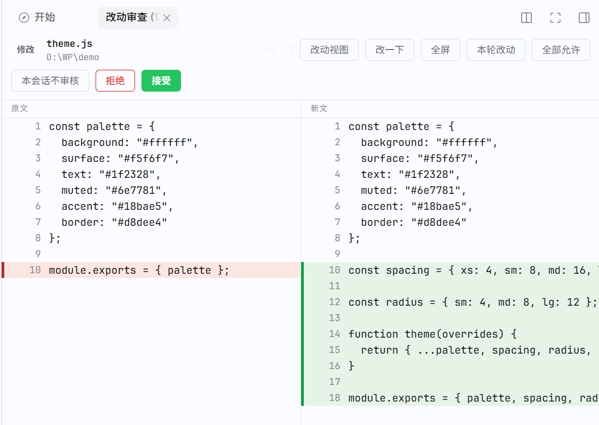

### 改一下

模型给的版本不一定是你想要的那版。顶栏「改一下」把右侧换成可编辑的文本框，左栏原文保持不动做参考，右栏标题变成「你的版本」，底部实时报字节数，改完点「应用」落盘的就是你的版本——不是模型的。

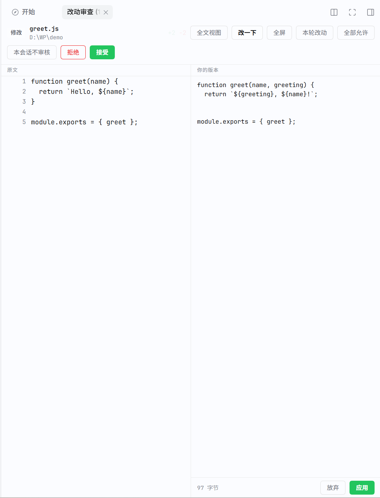

- 面板里改完直接写盘，然后以「已按你的版本落盘」进了「本轮改动」——它和别的条目一样能还原，因为磁盘上确实是你的字节
- **只有文件写入和编辑会出现这个按钮**：命令写出的内容、删除、超大截断的文件、二进制、目录都不给。命令的字节由 shell 决定，面板不知道最终是什么；删除没有新文可改
- 写盘前会核对文件是否还停在待审时的版本，中途被别人改过就报「文件已经变过了」，不覆盖
- 超过 8MB 时「应用」是灰的而不是消失——按钮突然不见比按钮点不动更让人困惑
- 只剩「你的版本」和「原样接受」两条路：想保留模型原文就点「放弃」，回到待审界面点「接受」

### 命令级审查

命令要碰的文件或内容只有 shell 运行时才知道（`iex $code`、内容来自 `$env:USERNAME`）——面板给完整命令行，并明说为什么算不出 diff，先把命令拆成「这条命令会做这些事」的步骤清单，原命令折在下面。

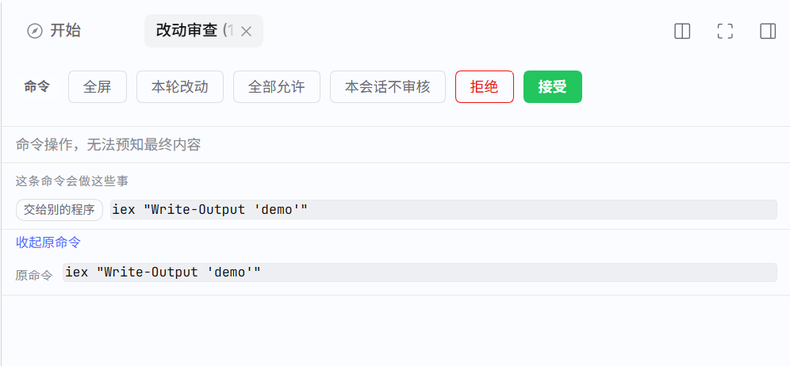

### 目标要运行时才算出来的审查

连**位置**都是 shell 运行时才拼出来的命令——`Set-Content -Path (Join-Path $pwd 'a.txt') -Value 'hi'`、`Set-Content -Path $out -Value 'hi'`——是最该被问的一类：插件连它要写哪个文件都不知道，最需要你知道它在写什么。

面板明说「命令要动的目标要运行时才知道」，把原命令摆出来，**不列假文件名**（以前这里会出现一个叫 `(Join-Path` 的「文件」，还标着「该文件内容未变」）。点「拒绝」就真的一个字节都没写。


### 删除级审查

`pwsh` 里的 `Remove-Item` / `rm` / `[IO.File]::Delete` 这类删除命令，面板把**将被删掉的整段原文**逐行标红列出来，一并给出原始命令行——先看清楚要没的是什么，再决定。

整份文件被删时，面板还会明说**一共多少行**（`整个文件将被删除，共 N 行`），全文视图里这句话取代那块空白的新文栏：只剩一片 `-` 行时，「删了什么」要自己数，行数才是那个立刻能判断「这值得拦吗」的量。

删的是**整个目录**时，面板不画行级 diff（目录没有行），直接说「整个目录将被删除，里面所有文件都会一起消失；这一步无法只恢复其中一个」，文件条那一格标「整个目录」而不是「该文件内容未变」。

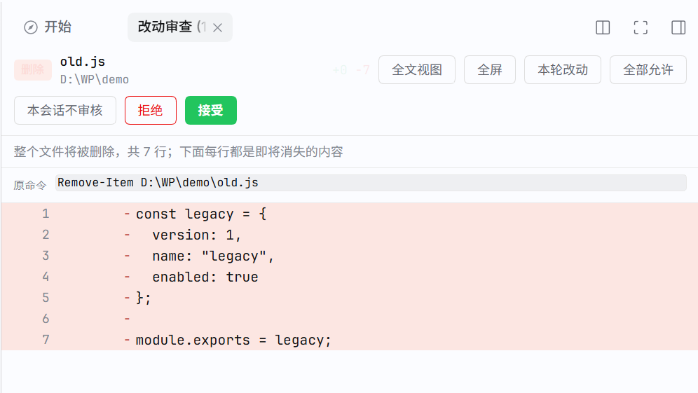

目录那一档的措辞是另一句：


### 多文件审查

一条命令动好几个文件时，上面多一条文件条：`N 个文件` + 每个文件一格，格子里是它的操作徽章、文件名和 `+N -N`（二进制说字节数）。**点哪一格就切到哪个文件的 diff**，接受/拒绝仍然只有一个按钮——shell 那条命令还是一条命令。

以前这种情况整条降级成「无法预知最终内容」，哪怕两个文件的新内容都是命令里写死的字面量。现在每个文件各算各的：能算的给真 diff，算不出的那一格自己标「该文件内容未变」或空白，不影响其它格。

**目录不占文件条**：`New-Item -ItemType Directory` 这类只是建目录的目标会被剔掉——目录没有内容可 diff，列进来只会得到一格「该文件内容未变」，跟它被列出的理由正好相反。真正删目录时它仍然在，标「整个目录」，因为那是实打实的损失。

**写进目录**（`Copy-Item a.txt -Destination lib`）是另一回事：新文件的名字此刻还不存在，没有文件名可显示，所以整条仍然停在命令级审查。

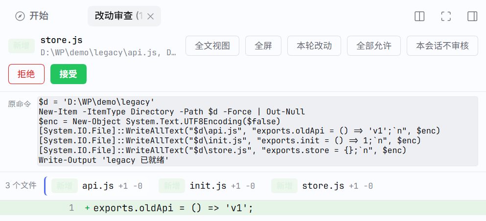

### 二进制 / sourcemap / 纯格式变化

这三种不画行级 diff，因为画出来没人读得下去：

| 情形 | 面板说什么 |
|---|---|
| 二进制（`.png`/`.zip`/`.exe`/`.pdf` 等，或读不出 UTF-8） | `二进制文件，N → M 字节` |
| `.map` sourcemap | `sourcemap，N → M 字节` |
| 只是换行符变了（LF ↔ CRLF） | `仅换行符变化（N → M 字节）` |
| 只是缩进/行尾空白变了 | `仅格式变化（缩进与空白），行内容未变` |

二进制只按字节数审查，**永远不给还原按钮**（没读到文本，没有可还原的副本）。纯换行与纯格式变化仍算改动、仍可还原，只是单独标出来——把四百行重新缩进画成四百行红绿，是最吵闹的「什么都没变」。

## 拦什么

| 操作 | 拦不拦 | 面板显示 |
|---|---|---|
| `write` 新建 / 覆盖 | 拦 | 新增或修改，全文 `+N -N` |
| `edit` 改文件 | 拦 | 统一 diff / 全文双栏，标出改动行 |
| `pwsh` 里的删除、覆盖命令 | 拦 | 命令原文 + 原文/新文 diff（能确定时） |
| 第三方 / MCP 工具的写操作 | 拦 | 按参数判定：名字或 `op` 里有增删改动词 + 参数里有真实路径，才拦 |
| `read` / `glob` / `grep` / 查看器 / 数据库查询 | 不拦 | — |

判定不看工具名白名单：**只有真正会改文件的调用才拦**。判据是「变异动词 + 真实路径」两半同时成立——`mcp__fs__write_file({path, content})` 拦，`mcp__fs__read_file({path})` 放行，`grep({pattern: "write", path})` 放行（动词出现在检索词里不算操作），`write_log({level, message})` 放行（有动词没路径，改不了文件）。

### `pwsh` 按「形状」识别，不靠命令名单

记住命令名单永远会漏。所以只要这条命令**可能改写文件**就先问你，判据是四类形状：

| 形状 | 例子 |
|---|---|
| PowerShell 动词-名词约定 | `Set-` `New-` `Remove-` `Clear-` `Rename-` `Move-` `Copy-` `Add-` `Out-` `Tee-` `Write-` `Save-` `Export-` `Import-` `Compress-` `Expand-` `Restore-` |
| .NET 成员调用 | `[System.IO.File]::Delete(...)`、`[IO.File]::WriteAllText(...)` |
| 把代码当字符串交给别的程序 | `cmd /c del`、`iex`、`powershell -EncodedCommand`、`node -e`、`python -c`、`bash -c` |
| 原地改文件的外部工具 | `git clean` / `git checkout -- ` / `git reset` / `git stash`、`truncate`、`dd`、`shred`、`unlink` |

所以 `Set-Item`、`New-Item`、`Tee-Object`、`Export-Csv`、`Rename-Item` 这些没被逐个列出的命令**同样会拦**。只操作内存的 `New-Object`、`Add-Type`、`Set-Variable`、`Clear-Host` 显式放行。

`.NET` 调用看的是**谁在调用**，不是成员名叫什么：`[SHA256]::Create()` 和 `[File]::Create('a')` 同名，前者只造一个内存里的哈希对象。所以一个成员调用只有在**所属类型够得着磁盘**（`File`/`Directory`/`FileInfo`/`DirectoryInfo`/`StreamWriter`/`ZipFile`/`FileSystem`…）**或者**第一个实参就是路径时才算改写。读字节、算哈希、编码转换（`[IO.File]::ReadAllBytes`、`[Text.Encoding]::UTF8.GetString`、`[IO.Path]::GetFileName`）都不会弹。


另外覆盖：

- 常见别名（`ri`/`rm`/`del`/`erase`/`rd`/`rmdir`/`clc`/`cli`/`ren`/`rni`/`mi`/`mv`/`sc`/`ac`/`cpi`/`cp`/`tee`/`ni`/`si`/`sp`/`mkdir`/`md`）与重定向 `>` `>>` `1>` `2>` `2>>` `*>` `&>` `>&`（`2>&1` 是合流，不写文件；`> $null` 是丢弃，也不算写；`>&file` 是 bash 的写法，会写文件）
- **全限定路径一样认**：`C:\Windows\System32\cmd.exe /c del a.txt` 里的 `cmd` 就是 `cmd`，带不带领格都一样
- **包装器会先剥掉**：`sudo rm a.txt`、`env FOO=1 rm a.txt`、`xargs rm`、`time rm a.txt` 剥完包装词再按原样判
- **`git` 按子命令判**：`pull`/`merge`/`rebase`/`cherry-pick`/`revert`/`checkout`/`switch`/`clean` 会改工作区 → 拦；`status`/`diff`/`log`/`show`/`branch -a`/`stash list` 只读 → 放行；`commit`/`add`/`tag`/`config` 只动 `.git/` 里的账本，不改工作区里的文件 → 放行（直接往 `.git/` 里写文件仍然拦）
- **打包解包会改一堆文件**：`tar -xf`、`unzip`、`7z x`、`jar xf` → 拦
- **copy/move/rename 的第二个位置参数是目标路径，不是内容**：`Copy-Item a.txt b.txt` 审的是 `b.txt`（新内容由工具决定），`Move-Item a.txt b.txt` 审的是「a 没了、b 有了」
- **交给宿主去跑的脚本照问**：`powershell -File deploy.ps1`、`pwsh -File build.ps1`、`bash deploy.sh`、`sh build.sh` —— 脚本的内容不在命令行上，照样按命令级审查（1.0.5 起）
- **脚本块里的命令**同样算数：`if (Test-Path $t) { Remove-Item $t -Force }`、`foreach (...) { ... }`、`& { ... }` —— 藏在里面的删除不会漏
- **写目标要运行时才算出来的命令照问**：`Set-Content -Path (Join-Path $dir 'a.txt') -Value 'hi'`、`Set-Content -Path $out -Value 'hi'` —— 连位置都是运行时拼的，最需要你知道它在写什么；面板把原命令摆出来，不列假文件名（1.0.4 起）
- **参数本身是个表达式时不列假文件名**：`Remove-Item (Get-ChildItem '*.txt')` 是一个参数，位置是运行时才算的。面板会把它当成「目标未知」的命令级审查，而不是把 `(Get-ChildItem` 当成一个要删的文件摆给你看（1.0.5 起）
- 带 `-WhatIf` 的干跑、只读管道、`git status` / `git log` / `git diff` 一律放行
- **分组括号不算动词的一部分**：`(Get-Process | Out-String)` 这种一条管道包在括号里的写法，按 `|` 切句后首尾会粘上 `(` 和 `)`。判定前会先剥掉它们，否则 `Out-String)` 看着不像 `out-string`、却命中了 `out-` 变异前缀，把「格式化一张表」报成了写操作。同理 `(Get-Content x | ConvertFrom-Json).version`、`Get-Process | Format-Table | Out-String)` 都是读

### 「清空文件」不算删除

`Clear-Content` / `clc` / `Clear-Item` **不算删除**：文件还在，只是内容没了，面板显示成「所有行被删掉」的 diff，`全部允许` 也照样放行。

真正让文件**消失或换位置**的才算：`Remove-Item`、`del`、`rd`、`Rename-Item`、`Move-Item`、`Clear-RecycleBin`。

## 能不能给我看 diff？

### 能算出新内容 → 给完整 diff

写入内容在命令里就写死了，且目标文件能读。所谓「写死」包括：

- **引号里的字面文本**：`Set-Content -Path 'a.txt' -Value 'hello'`、`'hello' > 'a.txt'`
- **同一命令里先赋值再写出的变量**：`$t = 'hello'; Set-Content -Path a.txt -Value $t`
- **.NET 调用的前两个实参**：`[System.IO.File]::WriteAllText('a.txt', 'hello')`
- **`$"..."` 里的插值**（引用的变量也确定时）：`` $dir = 'D:\w'; $js = "line one`nline two"; Out-File "$dir/probe.js" -InputObject $js `` → 解析成真实路径与真实三行文本（`` `n `` `` `t `` 一并还原）
- **here-string**：`@'...'@` 原样、`@"..."@` 插值。正文里的 `|`、`&`、花括号、引号都不会被当成命令分隔符

`Add-Content` / `Out-File -Append` 按追加算，新文件按新增算。

### 算不出来 → 只确认命令本身

路径或内容只能由 shell 运行时决定时，插件分两种情况处理，**两种都会弹**：

| 情形 | 举例 | 面板怎么说 |
|---|---|---|
| **路径算不出来** | 通配符 `*` `?` `[` `]`、没被赋值的变量 `$env:TEMP\x`、`$(...)`、`${...}`、运行期拼出来的路径 `(Join-Path $dir 'a.txt')` | 「命令要动的目标要运行时才知道」+ 原命令 |
| **路径知道、内容算不出来** | `Set-Content -Value $x`、`$js > file`、`Get-Process \| Out-File report.csv` | 「内容由工具决定」+ 文件名 |

> **1.0.4 的修复**：第一类里「路径算不出来」又分两种——**路径是通配符或变量**（看得见大概位置）与**路径要运行时才算出来**（连位置都是算的）。后者以前被当成噪音整条丢掉，命令**直接执行、一次都没问**：`Set-Content -Path (Join-Path $dir 'hello.txt') -Value 'hi'` 现在会挂起等你裁决，面板把原命令摆出来。点「拒绝」就真的不写。

两个例外：

- **`$env:NAME` 能查**：`Remove-Item "$env:TEMP\a.txt"` 会还原成真实路径 —— 落在临时目录的照放行，落在别处的照常问
- **逗号并列多目标**（`Remove-Item 'a.txt','b.txt'`）各自独立解析
- 文件名里本来就有的 `$`（如 `a$b.txt`）不算展开，仍按真实路径审查

真要弹时，面板先给「这条命令会做这些事」的步骤清单（`切换目录` / `设置` / `写入 <文件>` / `删除 <文件>` / `交给别的程序`），原命令折在下面点一下就展开 —— 不再是把三十行单行命令整条甩给你读。

清单按**整句**给，不按分隔符切：`splitStatements` 会把 `|`、`&`、`{}` 也断开（闸门需要这样才不会漏掉藏在 `if` 里的删除），但一句 `(… | ForEach-Object { … }) -join ''` 断成四段之后，四行都读不出原意。所以括号不平衡的碎片会被并进把它补全的那一句，等你看到的是完整的一步。

两个例外：

- **`$env:NAME` 能查**：`Remove-Item "$env:TEMP\a.txt"` 会还原成真实路径 —— 落在临时目录的照放行，落在别处的照常问
- **逗号并列多目标**（`Remove-Item 'a.txt','b.txt'`）各自独立解析
- 文件名里本来就有的 `$`（如 `a$b.txt`）不算展开，仍按真实路径审查

### 内联脚本先看它写了什么

`node -e`、`python -c`、`py -3 -c` 这类把源码写在命令行里的调用，**先判断这段源码会不会写盘**：

- 只读（读文件、打印、算长度、`readdir`、读 csv）→ **直接放行**，不再弹面板
- 出现写盘调用（`writeFileSync`、`appendFileSync`、`unlink`、`mkdirSync`、`shutil.copy`、`os.replace`、`to_csv`、`savefig`…）→ 照常弹，并给出步骤清单
- 出现以写模式打开的 `open(..., 'w')`、`(..., 'a')`、`(..., 'x')`、`(..., 'r+')` → 照常弹
- 出现能把控制权交给别的程序的东西（`child_process`、`execSync`、`spawn`、`eval`）→ 撤销只读判断，照常弹

`cmd /c del x`、`bash -c 'rm …'` **不**走这条判断：它们的 payload 是 shell，用一份 JS/Python 词表去判会把没列进词表的删除当成无害。这两种仍然整条确认。

### 外壳包住的东西按原样判

`cmd /c "node D:\WP\.dsh\tmp\probe.mjs 2>&1"` 这种「用别人跑一个一次性脚本」的形状，每天都在出现。以前外壳会把这层信息盖住：`cmd /c` 读作「把代码交出去跑」，整条就成了一个没有文件名的命令记录，于是每次都弹。

现在会把外壳剥开，**按剥开后的命令重判一次**，规则与裸跑完全相同：

- `cmd`、`powershell`、`pwsh`、`bash`、`sh`、`zsh` 后面跟 `/c`、`/k`、`-c`、`-Command` 时，取后面的整段当 payload；套几层都能剥（最多 3 层）
- payload 里**所有能看出来的路径都落在 `.dsh/` 或系统临时目录** → 直接放行，日志写 `shell-scratch`（这些位置本来就被跳过，删了写了都不问）。含 `$`、`%`、`..` 的一律不算
- payload 自己**看不出写入也看不出删除**（`node xxx.mjs`、`evil.exe`、`echo hi`、`git status`、`git clean -fdx` 之外的 git 写操作照问）→ 放行。**这一条是关键：外壳不许比裸跑更严**。裸跑 `node test\gate.test.mjs` 一直是被放行的，套个 `cmd /c` 反而弹窗，那才是噪音的来源
- payload **认得出写入或删除**（`del`、`Remove-Item`、`cp`/`copy`、`>` 重定向、`git reset --hard`）→ 照问，和裸跑一模一样

`cscript`、`wscript`、`mshta`、`-EncodedCommand` 不走这条（前者后面跟的是文件名，后者是 base64，都读不出来）。

引号只包住 payload 的前半段时（`cmd /c "del D:\WP\a.txt" 2>&1`），尾部的重定向**不会**让引号失效。以前这里只认「整段都被引号包住」，`2>&1` 一加就认不出，于是整行当成程序路径、删除直接放过 —— 这是会真的丢文件的漏判，现在只把引号之间那一段脱掉，后面的尾巴原样保留。

一段源码只要有一处说不清，整条命令就照常弹 —— 放行的门槛是「整条命令的每个内联脚本都被判定为只读」。

### 就地改写的工具

`npx prettier --write src/a.ts`、`eslint --fix`、`sed -i 's/a/b/' a.txt` 这一类**既不写 `-Path`、也不打重定向**的命令，以前一条操作都解析不出来，于是静静地放过了 —— 文件真的被改了，闸门却什么都没问。这是会丢东西的方向，现在认。

判据是**看标志而不是看工具**：`prettier x` 只打印、`prettier --write x` 才落盘，所以只有带 `--write`/`-w`、`--fix`、`--write`/`--apply`、`-i`/`--in-place`、`sed -i`、`perl -pi`、`-w`（gofmt/goimports）的调用才算改写；`black`、`isort`、`rustfmt`、`swiftformat` 默认就改写，反过来排除 `--check`/`--diff`/`--check-only`/`--lint`。`npx`、`bunx`、`pnpx`、`pnpm exec`、`yarn dlx`、`npm exec` 都会被跳过，看的是后面那个工具。

认出来之后**只问一次，问到的是「这条命令要动文件」**：

- 工具被点了名，且点的全是 `.dsh/` 或临时目录里的东西 → 不问（这些位置本来就被跳过）
- 什么都没点名（`eslint --fix`、`prettier --write .`）→ **照问**。这是最宽的写：它会扫整个工作树。`sed -i`、`black`、`rustfmt` 这种不给文件名就读标准输入、等于什么都不做，只有它们才放行
- 点了名但落在工作区里 → 照问。**但它点了哪些名，面板上就写哪些名**：文件条会逐个列出 `src/a.ts`、`src/b.ts`，不再是笼统的一句「命令操作」

「新内容是什么」由工具决定，所以这几个文件没有原文/新文对比，文件条上写「内容由工具决定」。写「该文件内容未变」是反的——它被列出来正是因为马上要变。

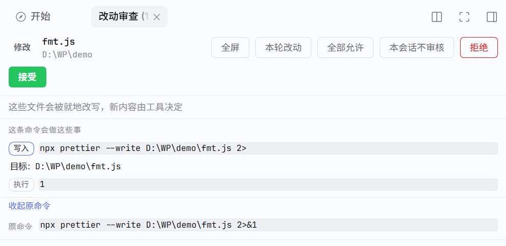

## 什么不会拦

- 只读工具
- 系统临时目录（`%TEMP%` / `%TMP%` / `/tmp`）
- 工作区下的 **`.dsh/` 整个目录**（一次性脚本、导出、截图、插件状态都落那儿）
- **生成物目录**：`__pycache__`、`node_modules`、`dist`、`build`、`out`、`target`、`coverage`、`.venv`、`vendor` 等（工具自己产出的东西，问你也是白问）
- **插件自己的源码**（否则插件改坏了就再也修不回来）
- **装依赖与跑构建**：`npm install`、`pnpm add`、`pip install`、`cargo build`、`go build`、`tsc`、`dotnet build`、`make` —— 装依赖和跑构建的动静太大、目标太散，问你也答不上来
- **只做排版的命令**：`Format-Table`、`Format-List`、`Format-Volume` —— `Format-*` 是给人看的形状，`Format-Volume` 写的是卷不是文件，diff 里根本没有它（1.0.5 起）

除此之外，只要落盘就一定会先问你。`.git/` 不在豁免之列——直接往 `.git/` 里写文件（`hooks/pre-commit` 之类）会拦；`git commit`/`git add`/`git tag` 这类只动账本、不碰工作区里文件的命令不拦。

**文件已知、内容由工具决定时也会问**：像 `Get-Process | Out-File report.csv`、`Copy-Item a.txt b.txt` 这种，插件算不出新内容，但它**知道**哪个文件会被写。于是照样停下来问，只是面板上说「内容由工具决定」而不是编一份 diff 出来——**问的是「这个文件会被改吗」，不是「这两段文字差在哪」**。原地改写的工具（`prettier --write`、`eslint --fix`）走的是同一条路。

## 面板细节

**顶栏**：操作徽章（新增 / 修改 / 删除 / 命令）+ 文件名与目录分两行（像编辑器的标签页）+ `+N -N` + 视图切换 + **改一下** + **全屏** + 本轮改动 + 历史占用（`12 条 · 3.4 MB`）+ 全部允许 + **本会话不审核** + 拒绝 + 接受。

**全屏**：侧栏只有整屏的三分之一宽，diff 在这种宽度里是一行三五个字地读。点「全屏」把这一栏撑满编辑区，再点「退出全屏」收回——只在这一侧栏真的提供了这个动作时才画这个按钮，宿主不给就不假装有。它读的是栏目自己的呈现状态，所以从面板里切、或从宿主 chrome 切，按钮的文案都跟着变。

只有命令级能确认的改动（`iex $code`、`git clean -fdx`）根本没有文件名，此时徽章写「命令」、下面直接给命令原文，**不会把动词当成文件名**。

- **多个待审项**在左侧列表纵向排列，逐条接受或拒绝
- **审查属于它所在的对话**：待审队列进程内共享，一个面板就是一块公共审查台——左边列出的是**所有**对话挂起的改动，点哪一条就审哪一条。但**权限按对话算**：面板每次都带上这条改动**自己所属的对话**去问宿主，宿主核对不上就当它不存在（`missing`），所以一个面板不能拿着 A 对话的改动去冒充 B 对话；而**历史与还原是严格按对话分的**——每个对话的快照在自己的目录里，别的对话既列不出它的历史，也还原不了它的文件
- **字体**：代码区 13px/20px，等宽栈 `JetBrains Mono → Fira Code → Cascadia Code → Consolas`，关闭连字（连字会把 `!=`、`->` 画变形）；正文系统无衬线
- **配色**：全部走宿主的 `--dsw-alias-file-diff-*` token，跟随亮/暗主题自动切换，不写死颜色
- **对比度**：主按钮沿用宿主的成功色（亮绿 `#22c55e`），字却用宿主最深的那档墨色而不是白字——白字压在这条绿上只有 2.3:1，看不清；宿主最深墨压上去是 8.6:1（1.0.5 起）
- **键盘可用**：能点的行（文件条目、历史条目、轮次标题）都能 Tab 过去，Enter 和空格等同点击（1.0.5 起）
- **窄栏**：侧栏窄到两栏对照挤不下时，上下堆叠，并给一行提示说明这是窄栏的选择（1.0.5 起）
- **失败提示**：失败会写成一句能看懂的话（「宿主拒绝了这个请求」而不是 `forbidden`），并且**留到你自己把它关掉为止**——下一次轮询成功不会顺手抹掉它（1.0.5 起）
- **空态**：显示提示，并把闸门自检信息收进一张卡片——闸门检查了多少次、最近一次是什么工具与结果、布防状态、心跳龄、待审条数、当前会话与工作目录、它见过的工具与调用形态，以及最近 12 次判定的流转。面板不弹的时候，先看这张卡。

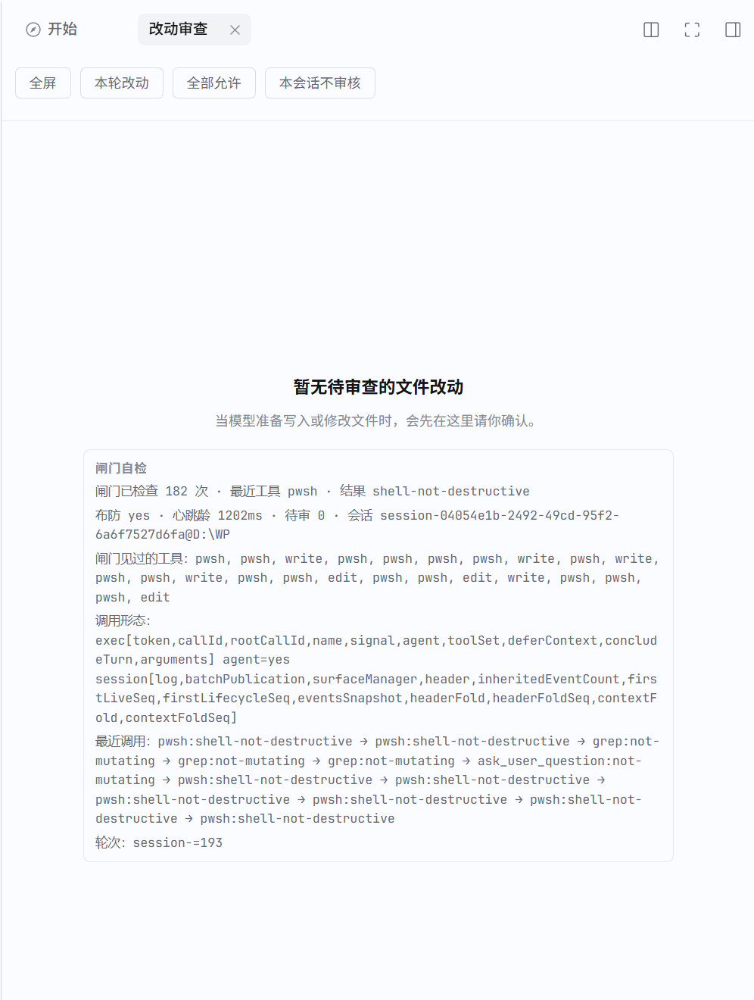

### 全部允许

懒得一条条点时按它：**这个对话**里后续写入不再询问，直到你再点一次关掉（重启 DSH 也恢复询问）。

- **按对话记**：这里打开不会替你放行别的对话，关掉也不会把别人的开关一起关掉
- 按钮**一直在顶栏**，包括清空后的空面板（放行之后没待审项，那正是你会停留的页面，开关不能跟着消失）
- 放行时变成「已全部允许 · 点此关闭」，随时能撤回
- 按下去会顺手接受屏幕上那一条
- **只有文件本身被拿走才照问**：`Remove-Item`、`del`、`rd`、`Rename-Item`、`Move-Item`
- 同一条命令里「写出临时文件 → 用掉 → 删掉」不算删除（那个文件本来就不存在，删它什么都没丢），整条直接过
- **放行不等于不记**：被它放过的写入照样进「本轮改动」，条目标「开关放行」，事后一样能还原。开关承诺的是「别再问我」，不是「别记得」

它的位置介于 Claude Code 的两个模式之间：比 `acceptEdits`（自动接受编辑、Bash 仍要问）宽一点，命令里的写入也一并放行；比 `bypassPermissions`（什么都不问）窄一点，删除和内容不可知的命令仍然停下来问。文件名和删除是不可逆的，这两件事不问就等于替你答了。

### 本会话不审核

比「全部允许」更彻底的一档，也在顶栏，但**按对话**：这个对话里不再弹面板、**也不再记录改动**，一直有效到你再点一次（落在 `~/.dsh/diff-review/review-off.json`，重启 DSH 仍然关着）。

三个开关的区别，一眼看清：

| 开关 | 还问你吗 | 还记录吗 | 范围 | 记得多久 |
|---|---|---|---|---|
| 全部允许 | 不问写入，删除和改名仍问 | **照记**（标「开关放行」） | 当前对话 | 重启恢复询问 |
| 本会话不审核 | **完全不问** | **不记** | 当前对话 | 重启仍然关着 |
| 插件市场禁用 | 不问 | 不记 | 所有对话 | 一直 |

- 关掉之后连快照都不抓：它承诺的是「这里别打扰我」，顺手记一份你没要的记录只是另一种打扰
- 按钮**常驻顶栏**，包括空面板——关掉之后本来就永远没有待审项，回来的路只能挂在栏上
- 关着时变成「已关闭 · 恢复审核」，面板上另有一行说明，免得安静的界面看起来像坏了
- 按对话记，`api.list` 下发的是 `{s1: true}` 这样的表，一个对话开着不会影响另一个
- 关掉之后**面板也不会再自己冒出来**：宿主会把所有对话的待审项一起报给界面，以前任何一条都能把面板顶到你面前（包括别的对话、子代理会话），现在只有你眼前这个对话有资格。想看去「本轮改动」里翻

### 什么时候会自己弹出来

只有一件事会把面板推到你面前：**你正在看的这个对话**出现了新的待审改动。

- 后台对话、子代理会话的改动照样排队、照样记进「本轮改动」，只是不抢焦点——它们不是你此刻在看的东西
- 被挡下的改动**不算「见过」**，你切到那个对话时它还会正常弹一次
- 关掉审核（「本会话不审核」）的对话什么都不弹，因为那边根本不会有新东西排进来

### `/diff-review` 命令

顶栏的两个开关，在输入框里也有对应的一条命令——**因为关了面板之后，恰恰是面板找不回来**：

```
/diff-review off      # 这个对话不再询问，也不再记录（等价于「本会话不审核」）
/diff-review on       # 重新开始询问（顺带把「全部允许」一起收回）
/diff-review status   # 现在什么状态：审查开/关、全部允许开/关、还有几项待审
```

- 命令只作用于**当前这个对话**，和面板上的两个开关是同两个开关（都落在 `~/.dsh/diff-review/review-off.json`）
- `on` 会把「全部允许」一起收回：既然开口要「问我」，就该真的被问到
- 宿主没有命令注册表时插件照常工作，只是没有这条命令（老版本 DSH 上不会有）

### 本轮改动与还原

顶栏的「本轮改动」按钮切到另一个屏幕：**本对话审查过的改动**，从新到旧，带结果（已接受 / 已拒绝 / 已超时 / **超时未确认 · 已拦下** / 已取消 / 开关放行 / 已按你的版本落盘）。

**一个文件在一轮里只有一条**：模型回答一条消息时可能把同一个文件改五遍，列表里是那五遍合成的一条——起点是本轮开头的样子，终点是最后一次的结果，`+X -Y` 按**净变化**算（改来改去可能显示 +0 -0）。

- 标注跟这一轮的整体形状走：本轮**新建**的文件无论后面又改了几次都标「新增」；最后**删掉**了标「删除」；其余是「修改」
- 本轮里建了又删掉的文件（净效果为零）**不留条目**——文件回到了本轮开始的样子，留着只是给一条没有意义的还原按钮
- 一条的还原 = **把这一轮对这个文件的改动整体撤回**，回到本轮开始前的样子，不是回到上一次写之前
- 升级前的老记录只在**同轮次**范围内合并：没有轮次的那些（0.7.0 之前的，或命令记录漏了轮次的）认不出属于哪一轮，硬合会把好几天的改动合成一条，所以原样留着，用「清空这一组」清掉

**按轮次分组**：标题写「本轮」「第 N 轮」「更早的改动（升级前）」，右边是这一组的「N 个文件 · +X -Y」。**默认只展开本轮**，更早的轮次折起来，点标题展开——一次长对话里，你会想看的永远是刚才那一下改了什么，而不是从头往下翻。

点任一文件行 → 整篇对比（左边原文、右边新文），和待审界面用的是同一套渲染；顶部可以切「改动视图 / 全文视图」，能还原的直接在那儿还原。

只记**新增 / 修改 / 删除**这三种真正落到文件上的操作。命令级条目（`iex $code`、只知命令不知效果的那种）不进历史——它没有可指认的文件，既还不了原也算不上一条改动，收进去只会把历史变成没人翻的日志。

- 每条在**受理之前**就已经抓好了原文快照，所以哪怕是你点了「接受」、5 分钟超时自动放行（**删除除外：超时的删除会被拦下**）、被「全部允许」直接放过，或者在面板里改成自己的版本，都能在这里把它还给磁盘
- 被开关放过的条目标「开关放行」而不是「已接受」：没人看过它，列表不该假装看过；在面板里改过的标「已按你的版本落盘」，因为磁盘上确实是你的字节
- 能还原的条目右边有「还原」；还原过的会标「已还原」，再点是拒绝（`already-restored`）
- **文件在那之后又变过就拒绝**：还原前会核对当前内容是否仍是那次改动写下去的样子（删除则核对文件是否仍然不存在），不一致直接报「文件在此之后又变过，已拒绝还原」。宁可不动，也不悄悄覆盖别人后来的写入。**核对由宿主原子完成**（写回时带上「我看到的版本号」，对不上就拒写），不是读一遍再写一遍中间留个空档
- **受保护的位置不给还原**：`.git/` 里、DSH 自己的目录、`~/.dsh/` 下、Windows 系统目录里的文件，即使有快照也不还原（报「这个位置受保护，不允许还原」）。快照是插件自己写的索引，而索引是可以被人改的文件——不给它一条「改索引就能往任何地方写」的路
- **没落盘的改动不给还原**：已拒绝的、还在待审的都没有按钮（`not-applied`）
- **读不出原文的不给还原**：超 4MB 的快照、被 `MAX_STORED_CHARS` 截断的改动只留记录，按钮不出现——用半截原文还原会把文件尾部切掉
- 快照存在 `~/.dsh/diff-review/history/`，按对话分目录、内容寻址去重（同一份原文写两次只占一份），每对话上限 200 条 / 128MB，超了从最旧的开始删
- **不再被引用的快照会被回收**：你自己改一版、或同一轮同文件被合并成一条时，旧的那份快照就没有任何条目再指向它了。写入方当场回收；此外每次启动会扫一遍所有对话，把安静的、超过十分钟没人动的孤儿副本删掉（十分钟是给第二个窗口留的余地——它可能刚写完副本、还没来得及写索引）
- **索引坏了会说**：磁盘上的索引读不出来时，坏文件被改名留底（`index.json.corrupt-<时间戳>`），面板的统计里标出「这个对话的索引坏过」——而不是把一段丢掉的还原历史安安静静显示成「没有改动」

**占多少、怎么清**：顶栏一直挂着一枚 `12 条 · 3.4 MB`，点它直接进「本轮改动」——数字和列表是同一个控件。列表顶部再写一遍总数，旁边是「清空全部」；每个轮次标题右边是「清空这一轮」。

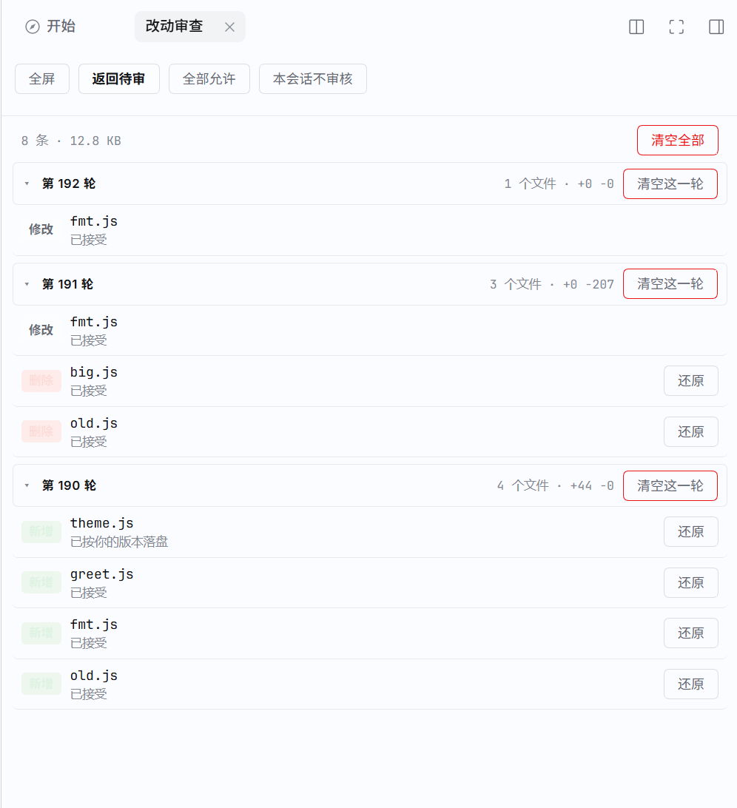

- **两步确认**：点一下按钮变「再点一次确认」，第二下才真删。快照删了就没了，一步到位太容易误触
- 清空会连磁盘上的 blob 一起回收，不是只从列表里划掉
- 清的是**本对话**的存档，别的对话各存各的，互不可见
- 只清存档，不动磁盘上的文件——「清空全部」不会碰到你工作区里的任何东西

## 安全阀

| 情形 | 行为 | 原因 |
|---|---|---|
| 侧边栏没打开 / 页面已关闭 | 放行 | 没人能审批时不能把 agent 卡死 |
| 你中断本轮（Esc） | 取消当次调用 | 跟随 `exec.signal` |
| 5 分钟没人理 | 写入放行；**删除拦下** | 未答复不等于拒绝，但删除拿不回来：没人点头的删除干脆别做（历史里标「超时未确认 · 已拦下」，文件原样还在） |
| 插件自己的源码 | 放行 | 否则插件坏了就再也修不了（自锁） |
| 临时目录 / 工作区 `.dsh/` | 放行 | `skipTemp` / `skipScratch`（`.dsh-tmp`、`.dshtmp` 这类只是名字像的不在此列） |
| 生成物目录（`__pycache__`、`node_modules`、`dist`、`build`、`out`、`target`、`obj`、`coverage`、`.venv`、`vendor` 等） | 放行 | `skipNoise`。整段匹配：`dist/` 跳过，`distro/`、`my-dist/`、`builder/` 照问；`bin`/`lib`/`public`/`src` 这类可能有人手写文件的目录、以及 `.git/`（`hooks/pre-commit` 会在下次提交时执行）**都不在名单里** |
| 二进制 / sourcemap | 按字节数报告，不给行级 diff、不给还原 | 读不出行就别假装能 diff；没有文本副本就没有可还原的字节 |
| 纯换行 / 纯格式变化 | 照常出条目、照常可还原，只多一行说明 | 字节确实变了，但把它画成四百行红绿等于什么都没说 |
| 命令写入内容由 shell 决定 | 只碰一个已存在的文件就放行；删除、多目标、`iex`/`node -e` 仍照问 | 看不见的字节问不出答案；但删掉的东西拿不回来 |
| 一条命令同时碰多个文件 | 照常弹一次，文件条里逐文件切换各自的 diff | 文件名本身就是这次审查要确认的东西 |
| 按了「全部允许」 | 本对话所有写入直接放行，直到手动关掉 | 文件被删除或改名仍照问；写出又删掉的临时文件不算；**放过也照样记历史** |
| 按了「本会话不审核」 | 本对话不问也不记，直到手动恢复或去 `review-off.json` 删掉那条 | 承诺的是「这里别打扰我」，顺手记一份你没要的记录只是另一种打扰 |

## 安装

```powershell
dsh plugin add https://github.com/wyk4447/dsh-diff-review.git
# 或简写
dsh plugin add github:wyk4447/dsh-diff-review
```

装完在 profile 的 `package.json` 里是版本号 / 仓库形态，与其它插件一致。改代码后需重装一次。

> **Fork 了？** 把上面两行的 `wyk4447` 换成你自己的用户名。

> **兼容的 DSH 版本**：`engines.dsh` = `>=0.2.1-rc.1 <0.4.0-0`（整个 `0.2.x` 与 `0.3.x`）。DSH 导入前会比对这条范围（预发布版参与匹配），不匹配就拒绝加载整个插件、把它变成一条 `disabled: true` 的孤儿行。0.1.0 写的是 `<0.2.2-0`，升级到 DSH `0.2.2-rc.1` 后就会被判不兼容；0.1.1 起放宽；**1.0.3 起放宽到 0.3.x**——原先的上界 `<0.3.0-0` 正好卡在宿主升到 0.3 的那一天，插件会被静默跳过（不是报错，是凭空消失）。
>
> 插件启动时会自检宿主提供的接口（`ctx.fs.*`、`ctx.get`、`ctx.effect`、`ctx.on`、`ctx.webServer.register`、`ctx.connection.requestRejection`）。少哪一个，右侧「改动审查」Tab 的自检卡会直接写出来，而不是让你对着一个不弹的面板猜。

> **构建脚本**：Git 托管的插件靠 `prepare` 脚本构建，pnpm 默认拦 `allowBuilds`。本插件**零依赖、没有任何 `prepare`/`install` 脚本**，正常不需要放行；只有你在这仓库里自己加了构建步骤时，才需要把 pnpm 打印的 key 写进 `~/.dsh/profiles/<profile>/pnpm-workspace.yaml` 的 `allowBuilds`。

### 本地开发（软链）

```jsonc
// ~/.dsh/profiles/<profile>/package.json
// dependencies 里加：
"dsh-diff-review": "link:<你 clone 下来的绝对路径>"
// dsh.profile.bundles 里也加 "dsh-diff-review"
```

改 `lib/*.js` 需重启 DSH 才生效（profile bundle 随 Host 启动加载，没有热重载）。

> **`link:` 装不上时**：`link:` 要求 pnpm 把整个依赖树重新解析一遍，只要有一个 git 依赖拉不下来（断网、代理没开）整次 install 就失败，而 `file:` 走本地拷贝不受影响。`file:` 得到的是**硬拷贝**：改完源码必须重跑一次 `pnpm install`（或重装插件）才会进 profile；`link:` 才是软链、改完即生效。二选一看你当前网络。

## 配置

在 `~/.dsh/profiles/<profile>/cordis.patch.yml` 里给对应条目加 `config:`：

```yaml
- id: diff-review
  name: dsh-diff-review
  config:
    files: true          # 拦 write/edit
    shell: true          # 拦 pwsh 里的破坏性命令
    skipTemp: true       # 跳过系统临时目录
    skipScratch: true    # 跳过工作区 .dsh 整个目录
    skipSelf: true       # 跳过插件自身（强烈建议保持 true）
    skipNoise: true      # 跳过生成物目录（__pycache__/node_modules/dist/.git …）
    history: true        # 抓原文快照，让已接受的改动能在「本轮改动」里还原
    trace: true          # 写诊断日志到 ~/.dsh/logs/diff-review.log（超过 5MB 自动轮转成 .1，只留一份）
    timeoutMs: 300000    # 文件审查超时（毫秒）
    shellTimeoutMs: 120000
```

所有键都可省略，缺省用上面的值。类型不符的键会被忽略（不做强制校验，插件零依赖）。

## 卸载

1. 删 `cordis.patch.yml` 里 `- id: diff-review` 那段（若你手动加过）
2. 从 profile `package.json` 的 `dsh.profile.bundles` 与 `dependencies` 里移除
3. 重启 DSH

本插件**没有**关掉任何内置插件，也没有改写宿主的 `disabled` 列表，卸载不留副作用。

## 自测

八套离线测试 + 两个检查脚本，不连 GUI、不写真文件：

```powershell
node test\gate.test.mjs      # 闸门：拦截 / 放行 / 接受 / 拒绝 / 中断 / 自我豁免 / 兜底 / 还原 / 多文件 / 二进制 / 格式化 / 面板内改写 / 历史统计 / 清空 / 同轮合并 / 本会话不审核
node test\render.test.cjs    # 面板：空态 / 改动视图 / 全文视图 / 滚动同步 / 多文件 / 命令级 / 全部允许 / 本会话不审核 / 历史分组 / 编辑器 / 清空按钮 / 侧栏图标 / 只给眼前的对话弹面板
node test\history.test.mjs   # 快照库：去重 / 上限回收 / 跨对话隔离 / 索引损坏 / 可还原性判定 / 占用统计 / 按轮清空 / 同轮合并成一条
node test\shell.test.mjs     # 命令识别矩阵：重定向 / 管道 / git / 打包解包 / 包装器 / copy-move-rename / 旗标 / 长脚本 / 交给宿主跑的脚本 / 表达式参数 / 「有意不拦」清单
node test\switches.test.mjs  # 审核开关：读写 / 删键 / 两窗口互不覆盖 / 损坏文件 / 写失败必须上报
node test\routes.test.mjs    # 路由层：状态码 / 原型污染 / 空 body / 超大 body / 错误码
node test\command.test.mjs   # /diff-review 命令：注册 / on / off / status / 复合会话 id / 落盘
node test\trace.test.mjs     # 诊断日志：超过 5MB 轮转成 .1 / 轮转后新行落在新文件 / 关掉时不写
node scripts\smoke.mjs       # 装配冒烟：包内容 / manifest / 宿主模块导出 / 装上之后的路由、闸门、接管、会话订阅
node scripts\lint.mjs        # 体检：每个文件能解析 / 中英词典键完全一致 / 每个查表都有键
```

断言数：闸门 **569**、快照库 **142**、命令矩阵 **91**、开关 **23**、路由 **29**、命令 **21**、诊断日志 **6**（合计 **1060**），面板 **16 组**，冒烟 **39** 项，体检 **122** 项。

> `npm test` / `npm run check` 把上面这些按顺序跑一遍；但**在含非 ASCII 字符的路径下 `npm` 认不出 `package.json`**（Windows 乱码路径报「Can't find package.json」）。本仓库所在路径就是这种，所以直接用 `node test\xxx.mjs`。
>
> 仓库里的 `.github/workflows/check.yml` 在 Node 20 与 22 上跑同一套（纯 ASCII 路径，`npm test` 正常）。

> 闸门与快照测试都把存储根指到系统临时目录（`DSH_DIFF_REVIEW_HISTORY_ROOT`）并在结束时删掉，跑测试不会往你的 `~/.dsh` 里塞任何东西。

<details>
<summary><b>闸门测试覆盖的 569 项断言</b>（点开）</summary>

`not-armed` 放行、布防后挂起、`decide accept` 放行、`decide reject` 拒绝且 reason 带路径、`abort` 取消、`edit` diff 两侧、`pwsh` 删除挂起与接受、`pwsh` 字面写入出真 diff（覆盖 / 追加 / 重定向 / 新建四种）、同一命令里赋值后写出的变量（`$t = 'one'; Set-Content -Value $t`、反引号转义还原、`$p = 'D:/w/a.txt'; Remove-Item $p` 解析成真实文件、`$dir` 参与路径拼接、`"hello $n"` 插值）、运行期才算出来的值照问并标成「内容由工具决定」（`$t = 'a' + 'b'`、`$env:USERNAME`、`$js > a.txt`）、按形状识别的改写命令（`Set-Item`/`Rename-Item`/`New-Item`/`Tee-Object`/`Export-Csv`/`[IO.File]::Delete`/`cmd /c del`/`iex`/`Invoke-Expression`/`node -e`/`python -c`/`powershell -EncodedCommand`/`git clean`/`git checkout --`/管道右端无目标）且参数是字面量时仍出真 diff、形状命中但没有文件名的条目（`iex`/`git clean`/管道右端）标记为命令级且不带路径（`op === 'shell'`、`displayPath` 为空，避免把动词当成文件名）、只碰一个已知文件且内容看不见的写入照问并标成「内容由工具决定」、**路径要运行时才算出来的写照问**（`Set-Content -Path (Join-Path $dir 'a.txt') -Value 'hi'` 与 `Set-Content -Path $out -Value 'hi'` 都会挂起、标 `computed-target`、面板不列假文件名、点拒绝真的没写）、`-WhatIf`/`Get-ChildItem`/`Write-Host`/`New-Object`/`Add-Type`/`Clear-Host`/`git status`/`node --version` 放行、通配与变量目标的命令级确认（`$p`/`"${target}"`/`$out`）且文件名里的字面 `$` 不被误判、脚本块里的删除（`if (...) { ... }`、`foreach (...) { ... }`、`& { ... }`）、同一命令内赋值参与路径解析、逗号并列多个目标、同一文件被写两次时顶栏只出现一次而两个不同文件按顺序都出现、`$env:TEMP` 目标按临时目录放行、自我豁免、临时目录豁免、工作区 `.dsh/` 整个目录豁免且不误豁免 `.dsh-tmp`/`.dshtmp`、`header.cwd` 缺失时用 `workingDirectory` 兜底、`ctx.get` 抛异常时仍能挂起、**全部允许**（同一轮里后续写入直接放行且诊断记为 `allow-all`、文件被删除或改名仍照问而 `Clear-Content` 直接过、`turn/end` 与新一轮提问都不动这个开关、关掉开关不需要有待审项、关掉之后的下一次写入重新挂起、**按对话记**——开在一个对话上不会放行另一个、关掉一个不会动另一个、不带对话的开关请求被拒绝 `missing`）、同一条命令里写出来又删掉的临时文件直接放行而删掉一个本来就存在的文件仍照问、**一个对话的改动不会被另一个对话看到或决定**（`list` 只回本会话、`detail`/`decide` 对别的会话返回 `missing` 且记录仍挂着）、**还原链路**（接受过的写入出现在历史里且带 `accepted` 状态与可用快照、还原后文件回到原文、第二次还原被拒 `already-restored`、文件在审查之后又被改过则拒绝还原 `stale` 且新内容保留、已拒绝的改动不给还原 `not-applied`、删除可以还原且字节真的回来了、别的对话既看不到这些历史也还原不了、不存在的 id 返回 `missing`）、**多文件审查**（一条命令碰两个文件只挂起一次、`files` 里两条、`detail.files` 各带自己的 rows 与新文与路径、接受后放行）、**二进制**（`.png` 被识别成 `binary`、不给行数、报 `0 → 1` 字节、`reviewable` 为真、不说「无法预知」、接受后放行）、**纯格式与纯换行**（重新缩进标 `note === 'formatting'`、CRLF 重写标 `note === 'line-endings'`，两种都仍可接受）、**按参数判定**（`mcp__fs__write_file` 被拦且新文能出 diff、`mcp__fs__read_file` 放行、`grep({pattern: 'write'})` 放行、`write_log({level, message})` 无路径放行）、**内联脚本只读识别**（`node -e` 读文件打印长度、`node -p process.version`、`python -c` 读文件打印、`sys.stdout.write` 打印、`console.log('write this to stdout')`、`readdirSync` 列表、`csv.reader` 读表共七种放行；`writeFileSync`、`appendFileSync`、`promises.unlink`、`open(...,'w')`、`shutil.copy`、`os.replace`、`child_process.execSync`、`eval(payload)` 共八种照常挂起并标 `shell-command`；一条只读脚本配一条写入脚本时整条仍挂起；**当初引发这次改动的「读 YAML 打印两个长度」那条命令不再挂起**）。
**`.NET` 按归属判定**：`[SHA256]::Create()`、`SHA256]::Create()` 后接 `ComputeHash`、`ReadAllBytes` + `Encoding::UTF8.GetString`、`Path]::GetFileName` 四种只碰内存的调用都放行；路径是表达式的 `[System.IO.File]::WriteAllText($p, …)` 仍挂起；当初被误拦的那条算哈希命令不再挂起且队列清空。
**步骤清单**：管道脚本挂起后 `steps` 非空、每一步括号都平衡、`(… | ForEach-Object { … }) -join ''` 合并成一步而不是碎成四段、没有一步只剩一个括号。
**外壳收窄**：`cmd /c`、`bash -c`、`powershell -Command` 包住的 payload 全部落在 `.dsh/` 或临时目录时直接放行且诊断记 `shell-scratch`；payload 自己看不出写入或删除时，外壳与裸跑同判（`cmd /c "node D:/w/real.mjs"`、`cmd /c "evil.exe"`、`cmd /c "echo hi"` 都放行——裸跑它们本来就被放行，外壳不许更严）；payload 认得出写入或删除时照问（`cmd /c "del D:/w/a.txt"`、`copy`、`>` 重定向、`bash -c "rm D:/w/a.txt"`、半惰性的 `cmd /c "… probe.mjs" ; del D:/w/a.txt`）；套多层外壳（`cmd /c cmd /c "del …"`）仍能剥到底；整个外壳被括号包起来（`(cmd /c "del …")`）时照样识别。
**分组括号**：`(Get-Process | Out-String)`、`Get-Process | Out-String)`、`(… | Format-Table -AutoSize | Out-String)`、`(Get-Content x -Raw | ConvertFrom-Json).version`、`Write-Host hi)` 五条都判为读。
**就地改写**：`prettier --write`、`eslint --fix`、`stylelint --fix`、`biome check --write`、`sed -i`、`sed -Ei`、`sed -i.bak`、`perl -pi -e`、`black`、`isort`、`gofmt -w`、`clang-format -i`、`rustfmt`、`pnpm exec prettier --write`、`yarn dlx prettier --write` 全部挂起并可接受；`prettier --check`、`prettier`（无标志）、`sed -n '1,5p'`、`black --check`、`rustfmt --check`、`tsc --noEmit`、`npm run build` 全部放行；点名 `.dsh/` 或临时目录的改写放行，点整个工作树（`eslint --fix` 无文件、`prettier --write .`）照问。
**`%VAR%` 展开**：`cmd /c "del %TEMP%\a.txt" 2>&1` 放行且无待审项；`%USERPROFILE%`、未定义变量、`Remove-Item "%TEMP%\…"` 解析成真实临时路径后按临时目录丢弃。

</details>

<details>
<summary><b>面板测试的 16 组覆盖 + 快照库 142 项断言</b>（点开）</summary>

用 `node:vm` 跑真实的 `lib/client.js`，桩掉 React/DOM/fetch，共 16 组：`empty diag`、`unified + full`、`multi-file review`、**`in-place rewrite`**、删除措辞与目录条目与全屏按钮、`scroll sync`、`command-level review`、`allow-all-switch`、**`session-off-switch`**、`session-scoped title`、`guide artwork`、**`history totals and clear buttons`**、**`computed target review`**、**`keyboard, narrow column and dismissible failure`**、**`only the on-screen conversation raises its panel`**，最后是 `client render smoke`。

具体验证：空态六行诊断（最后一行「轮次」，宿主一次都没报过轮次时显示 `-`）、改动视图有 `+`/`-` 标记、改写行只有真正变化的那几个字被加深高亮（前缀不被误涂）、全文视图有双栏与 gutter 竖条、**拖动一侧另一侧同步且不回弹**、**多文件时上面出现文件条并写「2 个文件」、列出两个文件名、默认画第一个文件的 diff、二进制那格报字节数而不是「该文件内容未变」**、删除态第二栏显示「文件将被删除」、命令级审查不出空代码区且用「无法预知最终内容」而不是「改动过大」、**命令级审查先给步骤清单（`切换目录`、`设置`、`写入` 三行，并单独点出目标文件）、原命令默认折叠、点开后才显示原文并能再收起**、命令级条目不再编造文件名（`iex $code` 的面板不显示任何文件名）、「全部允许」开关始终在顶栏、**放行之后队列清空的那一屏也仍然在**、**一个对话的开关状态不会串到另一个对话**、关掉后仍能找到入口、**标签页计数只算本对话**、侧栏「开始」页的画走 `guide` 条目自己的 `icon`（不是清单里的 `icon.svg`）、**历史屏幕在有记录时列出条目并标「已还原」、且只给可还原的条目出「还原」按钮（已还原的、已拒绝的、快照不完整的都不出）、「已按你的版本落盘」条目出按钮且标出自己的状态**、**历史按轮次分组：本轮默认展开、更早的轮次折叠并写「N 个文件 · +X -Y」，本轮的文件可见而更早轮次的不出现**、**编辑器：右侧是 `textarea` 且装着模型给的新文、底部报字节数、有「应用 / 放弃」，命令与删除不出现「改一下」**、**历史勾当：顶栏写「2 条 · 1.5 KB」，历史屏有「清空全部」与每轮的「清空这一轮」，两个按钮都带 `data-danger`**、**就地改写：命令行里的两个文件名各自出现在文件条上、每格标「内容由工具决定」而不是「该文件内容未变」、也不再笼统地写「命令操作，无法预知最终内容」**。

`test/history.test.mjs` 直接测快照库本身：**占用统计（条数 / 字节 / 空会话 / 关闭态）、清一轮只删那一轮并回收其 blob、清无轮次那组、清全部后目录消失、跨会话清不动别人的、重复清与空会话清无害**、记录被拒的条件（无会话 / 无路径 / 多目标命令 / 内容不可知的命令 / **命令级条目** / **未知操作名**）、截断的快照只留记录不可还原、删除按「文件应当不存在」校验、新建可撤销、关闭开关后全静默、跨对话隔离、**会话 id 带 `../` 不会逃出存储根**、最新在前、内容寻址只存一份 blob、超 200 条从最旧开始删且回收孤儿 blob、**索引损坏读成空但坏文件被留底改名成 `index.json.corrupt-<时间戳>`、并且统计里标出「这个对话的索引坏过」、之后仍能写入**、**磁盘上的索引里点名的每个 blob 都真的在**（索引先写、blob 后收；反过来写，崩在两步之间就会让整个对话的还原无声失效）、`forget` 幂等、**超 4MB 的快照记条目但不可还原**（字节上限必须是字符上限的四倍——80 万个汉字是 2.4MB，顶到 2MB 时快照会被悄悄丢掉，条目看着能还原，按下去却还原不了）。

`test/shell.test.mjs` 把命令识别的判断摊成一张矩阵：**重定向**（`>`、`>>`、`1>`、`2>`、`2>>`、`*>`、`&>`、`2>&1` 合流不写文件、`> $null` 丢弃不算写）、**动词归一**（带引号的 cmdlet、全限定路径 `C:\Windows\System32\cmd.exe`、`$(Remove-Item …)`）、**管道右端写入**（`Get-Process | Out-File` 这类「文件已知、内容由工具决定」挂起而不是放行）、**git**（`pull`/`merge`/`rebase` 改工作区 → 拦；`commit`/`tag`/`remote add` 只动 `.git` → 放行）、**打包解包**（`tar`/`unzip`/`7z`/`jar` → 拦）、**包装器**（`sudo`/`env`/`xargs` 后面照判）、**copy/move/rename**（目标路径不当内容、move/rename 的新路径不丢）、**旗标与 cmdlet**（`-OutFile`/`-DestinationPath`/`[IO.StreamWriter]::new()`）、**长脚本**（45 条无害命令放行、45 条里夹一条 `Remove-Item` 仍拦）、以及一张**「有意不拦」清单**（`npm install`、`pnpm add`、`pip install`、`cargo build`、`go build`、`tsc`、`dotnet build`、`make` —— 装依赖和跑构建的噪音比价值大，不拦）。

`test/switches.test.mjs` 管审核开关：读写、删键、**两个窗口各写各的不会互相抹掉**、坏文件读作「没关任何对话」、版本不对时忽略、只留真值、**写失败必须报 `saved:false`**（落盘不成功却回「已关闭」，是比没关更糟的一种骗人）。

`test/routes.test.mjs` 管路由层：200/405/404/400/403、**`__proto__`/`constructor`/`toString`/`hasOwnProperty` 都不算方法**、空 body 当「无参数」返回 200、超大 body 报 400、`applyEdited` 的 missing/empty/unchanged/not-editable、`restore` 的 missing、**受保护的位置仍然只审查不还原**。

`test/command.test.mjs` 管 `/diff-review`：命令注册上了、`off` 真的落盘（写进 `review-off.json`）、`on` 真的把这条从名单里删掉、`status` 说得清现在的状态、**宿主给的复合会话 id（`session-…@D:\wp`）要落到裸 id 上**（落到另一个键上看起来像成功了，其实什么都没变）、不认识的说法给用法而不是默默不理。

`scripts/smoke.mjs` 是装配冒烟：包里该有的文件都在、manifest 字段齐、宿主模块导出的东西齐、**装上去之后路由、闸门、接管、会话订阅都真的挂上了**、`lib/client.js` 在 VM 里能注册。

`scripts/lint.mjs` 是体检：**每个文件都过 `node --check`**、**中英两本词典的键完全一样多、没有一个多一个少**、**每一处 `t("键名")` 都查得到**——上一版面板漏一条中文就会显示成 `editReasonStale` 这种原始键名。

</details>

## 排错

没被拦住时，先看日志，再看面板。

### 日志（推荐，不依赖打开侧栏）

`trace: true`（默认）时，每次闸门调用、挂起、裁决、路由拒绝都会追加一行到 `~/.dsh/logs/diff-review.log`（Windows：`C:\Users\<你>\.dsh\logs\diff-review.log`）。日志超过 5MB 会轮转成 `diff-review.log.1`（只留一份，两份合计约 10MB 封顶），最新的证据永远在正在写的那个文件里。想让日志换个位置，设 `DSH_DIFF_REVIEW_TRACE_FILE`。

```powershell
Get-Content ~\.dsh\logs\diff-review.log -Tail 30
# 只看某个工具
Select-String -Path ~\.dsh\logs\diff-review.log -Pattern '"tool":"write"'
```

日志只记**状态变化**：轮询心跳首次出现或间断后恢复各记一次（`poller`），不会每 1.2s 刷屏。没有 `poller` 行 = 浏览器半从没连上，闸门必然一直「未布防」。

典型序列：

```
... poller {"first":true,"gapMs":-1}                  ← 侧栏连上，闸门开始布防
... park {"tool":"write","path":"...","pending":1}    ← 拦下了，等你点按钮
... verdict {"id":"...","outcome":"accept"}           ← 你点了接受，随后工具真的执行
```

### 面板

打开右侧「改动审查」Tab，空态直接列诊断：

- `闸门已检查 N 次 · 最近工具 X · 结果 Y` —— `Y` 是放行原因，见下表
- `布防 no · 心跳龄 -1ms` —— 页面从没轮询过，即 Tab 没打开
- `最近调用：write:not-armed → read:not-gated` —— 按时间顺序看最近 12 次

| `结果` | 含义 |
|---|---|
| `not-armed` | 侧边栏没在轮询（Tab 没开 / bundle 没加载），正常放行 |
| `not-mutating` | 工具的名字与参数都看不出在改文件（`read`、`grep`、`web_fetch`、查看器、数据库查询） |
| `no-session` | 拿不到会话工作目录 |
| `temp-skipped` / `scratch-skipped` / `self-skipped` / `noise-skipped` | 命中临时目录 / 工作区 `.dsh/` / 插件自身 / 生成物目录豁免 |
| `identical` / `edit-no-match` / `edit-ambiguous` | 改动本身无效或歧义，交给宿主自己报错 |
| `shell-not-destructive` | `pwsh` 命令不含破坏性操作 |
| `shell-scratch` | 外壳（`cmd /c`、`bash -c`…）包住的 payload 里每个路径都在 `.dsh/` 或临时目录，无事可报 |
| `script-read-only` | 命令里是 `node -e` / `python -c` 这类内联脚本，且每段源码都只读（不写盘、不以写模式 `open`、不启动别的程序） |
| `intent-skipped` / `intent-error` | 看着像在改文件，但路径落不到存在的文件上 / 读路径时出错 |

## 实现要点

- **闸门**：`tools/pre-execute` 的 async waterfall。挂起时只 await 一个 Promise，同时监听 `exec.signal`，宿主等多久都不会 abandon 我们的 promise。
- **拦谁**：不靠工具名白名单。`write`/`edit`/`pwsh` 是精确 diff 的已知工具，其余一律按参数判定——工具名或 `op`/`action`/`type` 参数里出现变异动词，**且**参数里有真实路径，两者同时成立才拦。这样第三方 MCP 文件服务也能被拦，而 `grep({pattern: "write"})` 不会被误拦。
- **多文件**：一条命令按路径分组，每组独立 replay 出 before/after，`files[]` 随 `list` 只发摘要、随 `detail` 发全部 rows。面板切文件是本地状态，不发请求。目录不是文件：除非它是被删除的对象，否则不进 `files[]`；而「写进目录」的路径要单独记住，否则目标被剔掉之后这条命令会被误判成「只碰一个看不见的文件」而直接放行。
- **算出来的目标**：`computed`（路径要运行时才算出来）跟通配符是两回事 —— 通配符的位置是真的、文件列表不知道；算出来的路径连位置都是算的。判据是「路径里带变量或函数调用」（`$`、`${`、`$(`、`(`）。这类目标按「形状」处理：面板给命令原文，不给假文件名，闸门照问。
- **全屏**：侧栏自己的服务面上就有 `commandTarget()` + `toggleFullscreen(target)`，不需要另建界面。按钮只在宿主真的提供这两个方法时才画，动作包在 try/catch 里——宿主拒绝就保持原布局，不假装切换成功；按钮文案读的是 tab 自己的呈现状态，所以两边都能切。
- **二进制 / 格式噪音**：扩展名先判 `kind`（`text`/`binary`/`sourcemap`），二进制只算字节数不读文本；文本再判 `note`（`line-endings`/`formatting`）。`computed`（有真 diff）与 `understood`（知道结果，哪怕只是字节数）分开，只有前者能驱动快照——二进制没有文本副本，所以永远不给还原。
- **内联脚本**：`node`/`python` 带 `-e`/`-c` 时先取 payload 原文，抹掉字符串字面量与 `console.log`/`process.stdout.write`（打印不是写盘），再把标识符去掉下划线后比对写词表；`open` 的写模式靠正则带调用括号判，避免只读脚本被拦。任何一处判不清就整条照常确认，`cmd /c`、`bash -c` 不走这条捷径。
- **步骤清单**：算不出 diff 的命令在服务端就按语句拆成 `steps[]`（`cd`/`note`/`write`/`delete`/`run`/`opaque`），随 `list` 一起透出。面板先画清单、原命令折叠；没有清单时原命令直接展开，不会出现「藏起来的唯一审查内容」。括号不平衡的碎片会并进补全它的那一句 —— `splitStatements` 的断句是为闸门服务的，不该决定读者看到几行。
- **`.NET` 归属**：成员名只是线索，`::` 前面的类型才是判据。`SHA256]::Create()` 造的是内存对象，`File]::Create('a')` 才碰磁盘；两者同名。所属类型够不着磁盘**且**没有路径实参时，这个调用不算改写。
- **通道**：自建同源 HTTP 路由 `/diff-review/api/{list,detail,decide,history,historyClear,historyDetail,restore,applyEdited}`，前面挂 `ctx.connection.requestRejection` 做浏览器信任校验。Electron 壳把 `dsh-app://app/` 的请求转发到 Host 并自动带认证 cookie，所以浏览器侧同源可达；从 Node 直接探测会 403，属正常。
- **diff**：自己算 LCS（`Int32Array` DP，超 400 万格降级为全删全增），零外部依赖。
- **布防**：侧边栏轮询 `list`，该调用同时刷新心跳；心跳 180s 内有效才算「布防」，否则一律放行。**有改动时 1.2s 一次、没事时 5s 一次、页面看不见时 15s 一次**，同一时刻只发一个请求——原来是不管有没有事都每 1.2s 敲一次门（一分钟 75 次）。窗口不可见时 Chromium 把定时器压到约 60s 一跳，窗口必须留得比这个大，否则切走窗口就等于放行。
- **快照**：`lib/history.js`，整份原文副本而不是补丁链（补丁链要每一跳都能重放，副本就是状态本身，还原不会半路失败）。内容寻址（`sha256` 命名 blob）自动去重，`index.json` 先写临时文件再 rename（临时名带进程号与计数，两个窗口不会撞名）。**索引先落盘、blob 后回收**：反过来写的话，崩在两步之间会让整个对话的还原无声失效，而面板显示成空 diff。索引坏了读成空、坏文件改名留底、统计里标出「这个对话的索引坏过」——不抛异常，因为抛异常会连带闸门一起挂掉。抓取时机在**你答复之前**——超时是 fail-open 放行（**删除除外：没人点头的删除会被拦下，文件原样还在**），等答复完再抓原文已经没了。删除走 `ctx.fs.deleteFile`、还原走 `ctx.fs.writeText`，还原时带上宿主给的版本号做原子校验（对不上就拒写），另有一层路径围栏挡住 `.git/`、DSH 自己的目录、`~/.dsh/` 与 Windows 系统目录。
